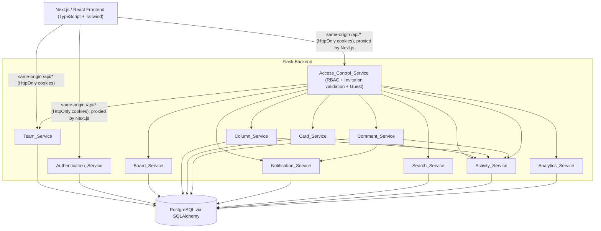
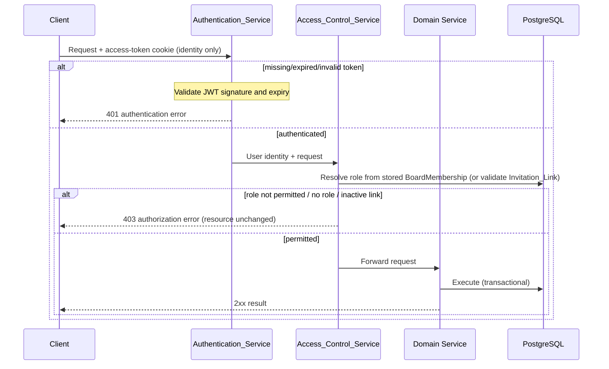
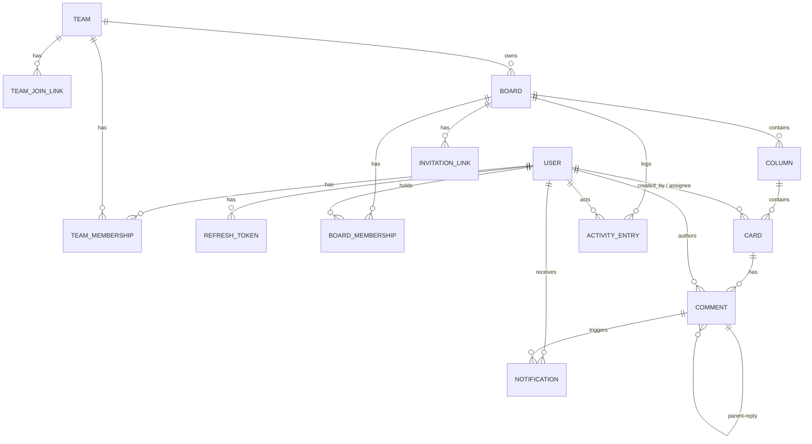

# Design Document

## Overview

This document specifies the technical design for a collaborative team task management web application (Trello-style). The system lets Teams organize work on Boards containing ordered Columns, each holding ordered Cards. It supports Card CRUD and drag-and-drop movement, threaded Comments, mention Notifications (HTTP polling), Card search, an Activity Log, Board Analytics, invitation-link Guest access, and role-based access control across Guest/Member/Admin roles, all gated behind email/password authentication.

The design traces directly to the acceptance criteria in `requirements.md`; requirement clauses are referenced inline as `R{n}.{m}` (for example, `R2.3` is Requirement 2, criterion 3).

### Technology Stack

- **Frontend:** Next.js (App Router) + React + TypeScript (strict mode) + Tailwind CSS. Drag-and-drop via `@dnd-kit/core` and `@dnd-kit/sortable`. HTTP polling for notifications (no WebSockets). All application code lives under `frontend/src/`.
- **Backend:** Python 3.14 + Flask (application factory + blueprints), organized as service modules behind a REST JSON API under `backend/flask_app/`. Flask blueprints map to the services named in the requirements glossary, plus a `teams/` module for Team_Service. Input validation uses Marshmallow (request shape and format); rules that need the database stay in services. Backend libraries: Flask-SQLAlchemy, Flask-Migrate, PyJWT, `psycopg[binary]`, `python-dotenv`, `gunicorn`, `argon2-cffi`, `marshmallow`.
- **Database:** PostgreSQL accessed through SQLAlchemy ORM, with Alembic migrations. No Docker. Local PostgreSQL for development; Supabase-hosted Postgres (plain PostgreSQL via SQLAlchemy, Session pooler, `sslmode=require`) in production.
- **Auth:** Stateless JWT **Access_Token** (15 minutes) carrying **identity only** (user id and expiry, no role claims — R15.13) + a hashed, revocable **Refresh_Token** (7 days). Both are delivered as `HttpOnly` cookies (`SameSite=Lax`, no `Domain`, `Secure` controlled by `COOKIE_SECURE`); the refresh cookie is scoped to `/api/auth/refresh` and `/api/auth/logout`. Passwords hashed with argon2 (`argon2-cffi`).
- **Deployment:** Frontend on Vercel, backend on Render (native Python runtime, `gunicorn`), database on Supabase Postgres, all from this monorepo. The browser only calls same-origin `/api/*` paths, which Next.js rewrites to the backend; no CORS.

### Design Goals and Non-Functional Targets (R14)

- p95 latency < 300 ms for non-search, non-analytics, non-permanent-delete API requests under up to 100 concurrent users (R14.1). Achieved via indexed queries, bounded page sizes, and avoiding N+1 access with eager loading.
- 99.5% monthly availability measured by a health-check endpoint (R14.2).
- Responsive layouts: full board without horizontal scroll at >= 1024px (R14.3); usable, non-overlapping controls below 1024px (R14.4).
- Independent concurrent writes with no lost updates, enforced via optimistic concurrency on Card and Comment edits (R14.5, R13).
- Target p95 < 300 ms for regular (non-search, non-analytics, non-permanent-delete) requests; `GET /api/health` is public, returns 200, and never touches the database (R14.2).

The p95 latency (R14.1) and 99.5% availability (R14.2) figures are design targets for the application under normal operation, not guarantees about the hosting tier. On the free deployment tiers, a Render backend cold start after idle and a Supabase project resuming from its inactivity pause can make the first request after idle exceed these targets; such cold-start and resume latencies are expected and fall outside the steady-state targets.

## Architecture

### High-Level Topology



### Request Flow

Every API request flows through two gates before reaching a domain service:

1. **Authentication gate (Authentication_Service).** Reads the JWT Access_Token from its `HttpOnly` cookie and validates its signature and expiry. The token carries identity only (user id and expiry); it has no role claims (R15.13). If the request is unauthenticated, or the token is expired/invalid, it is rejected with an authentication error before any Board role is evaluated (R12.6, R15.9, R15.10). Guest routes under `/api/guest/<token>/...` are exempt from this gate and are governed by Requirement 11.
2. **Authorization gate (Access_Control_Service).** Resolves the authenticated User's role on the target Board by reading the stored `BoardMembership` for that User and Board on this request (or validates an Invitation_Link for Guest access), then either forwards the request to the target domain service or rejects it with an authorization error (R12.1–R12.5). Team-scoped endpoints resolve the User's Team_Role from the stored `TeamMembership` the same way.



Role resolution reads the stored `BoardMembership` (and, for Team-scoped endpoints, the stored `TeamMembership`) for the authenticated User on every request; the Access_Token never carries role claims (R15.13). Because the role is read fresh from stored membership each time, a role change or a removal takes effect on the Member's very next request, with no need to refresh or re-issue a token (R10.2, R10.3, R12.1, R16.6). See Authentication & Authorization below.

### Service Responsibilities

| Service | Responsibility | Primary Requirements |
| --- | --- | --- |
| Authentication_Service | Registration (account only, no auto-login), login (sets auth cookies, returns identity), logout (refresh-token revocation, clears cookies), JWT access-token issuance, token refresh, auth enforcement, Profile (display name edit, password change) | R15, R18, R12.6 |
| Team_Service | Team creation, Team membership listing, Team_Join_Link lifecycle (generate/revoke/list/preview/accept) | R16, R17 |
| Access_Control_Service | RBAC decisions from stored membership, Board membership/role management, invitation link lifecycle & validation, anonymous Guest read access | R10, R11, R12 |
| Board_Service | Board create/update/archive/restore/permanent-delete, default columns, settings | R1 |
| Column_Service | Column create/edit/reorder/delete with contiguous reindexing, empty-before-delete rule | R2 |
| Card_Service | Card CRUD, assignment, move/reorder with reindexing, position persistence, optimistic concurrency | R3, R4, R13 |
| Comment_Service | Top-level comments, threaded replies, edit/delete with cascade, optimistic concurrency | R5, R13 |
| Notification_Service | Create mention notifications, cursor-paginated retrieval, unread filter, mark-as-read | R6 |
| Search_Service | Case-insensitive title substring search across accessible boards, capped+ordered results | R7 |
| Activity_Service | Record and page Board activity entries | R8 |
| Analytics_Service | Card totals, per-column counts, completion rate, activity-by-day | R9 |

### Transactional Boundaries

All multi-step mutations (atomic multi-field updates R1.10/R3.10, reindexing R2.3/R2.5/R4.2, cascade delete R1.6/R5.4, create-with-side-effects) execute inside a single database transaction. Side effects that must be consistent with the primary write—Activity_Entry recording (R8) and Notification creation (R6.1)—are committed in the same transaction as the triggering operation so that an activity/notification exists if and only if its triggering mutation succeeded.

Two creation flows are explicitly single-transaction:

- **Board creation** persists the Board, the creator's Admin `BoardMembership`, and the three default Columns ("To Do", "Doing", "Done" at indices 0, 1, 2) together in one transaction, so a Board never exists without its creator-Admin membership or its default Columns (R1.1, R1.2, R1.11, R1.12).
- **Team_Join_Link acceptance** creates the joining User's `team_regular` `TeamMembership` in a single transaction, so the membership either exists in full or not at all (R17.3).

## Components and Interfaces

### Backend Layering

Each service package holds `routes.py` (a Flask Blueprint with thin handlers, max 5 lines, full `/api` paths and no `url_prefix`), `service.py` (`*_service` business logic, one transaction per route-called function), `schema.py` (Marshmallow input schemas; omitted when a module takes no body or query string), and `__init__.py` (exports the Blueprint). Cross-module calls go through service functions, never another module's routes; models live only in `models/`.

```
backend/flask_app/
  app.py                 # app factory (create_app), blueprint registration, error handlers
  extensions.py          # SQLAlchemy db, migrate; metadata naming_convention
  config.py              # settings from env (DATABASE_URL, JWT_SECRET_KEY, COOKIE_SECURE, ...)
  models/                # SQLAlchemy entities (Data Models section); base.py = BaseModel
  auth/                  # Authentication_Service: routes + logic; @token_required, auth cookies
  access/                # Access_Control_Service: membership, invitations, Guest routes;
  #                        rbac.py holds @require_role + the pure role-decision function
  teams/                 # Team_Service: Teams, Team memberships, Team_Join_Links
  boards/                # Board_Service
  columns/               # Column_Service
  cards/                 # Card_Service
  comments/              # Comment_Service
  notifications/         # Notification_Service
  search/                # Search_Service
  activity/              # Activity_Service
  analytics/             # Analytics_Service
  common/                # exceptions.py, validation.py (BaseSchema, TrimmedStr, NonBlankStr,
  #                        load_schema), serialization.py (read_json, read_query, json_response),
  #                        ordering.py (reindex), cursor.py, pagination.py (page-size caps),
  #                        time.py (utc_now), health.py (public GET /api/health)
```

`access/` may define two Blueprints: `access_bp` (members and invitations) and `guest_bp` (the `/api/guest/*` routes). `common/health.py` and `access/rbac.py` have no routes structured per the module convention.

### Cross-Cutting Interfaces

**Authentication decorator.** `@token_required` (in `auth/`) reads the Access_Token from its cookie, validates it, loads the User, and raises `AuthenticationError` before the handler runs. Routes needing only identity (teams, notifications, search, `GET /api/auth/me`) use it directly.

**RBAC decorator.** `@require_role('member' | 'admin')` (in `access/rbac.py`) runs the authentication check first, then resolves the target Board from the route parameters and reads the caller's role from the stored `BoardMembership` in the database — never from the token (R12.1). It either proceeds or raises `AuthorizationError`. The pure role-decision function (role + operation → allow/deny) lives alongside it so it can be property-tested without the database. Guest read access is handled by the separate Guest routes in rule 3 of `backend.md`, not by this decorator.

**Input validation (Marshmallow).** Every request body or query string is validated by a schema in the module's `schema.py` before the service runs, via `load_schema(SomeSchema(), read_json())` or `read_query()`. Schemas inherit `BaseSchema` (`unknown = RAISE`), use snake_case field names (conversion from camelCase happens in `read_json`/`read_query`), and never use `data_key`. `version` is never `required` in a schema: a missing `version` raises `ConflictError` in the service (R13.5); a present non-integer `version` is a validation error. Rules needing the database (Assignee is a Board Member, target index in range, parent Comment on the same Card) run in the service.

**Serialization helper.** `read_json()` / `read_query()` convert incoming camelCase keys to snake_case; `json_response(payload, status)` builds the response, converts snake_case keys back to camelCase, and formats UUIDs as strings and timestamps as ISO 8601 UTC. This single helper in `common/serialization.py` is the only place field-name conversion happens; services and routes never rename fields by hand.

**Ordering helper.** A shared `reindex(items)` utility assigns contiguous `order_index` values `0..n-1` in the current sequence order. Used by Column reorder/delete (R2.3, R2.5) and Card move/reorder/delete (R4.2, R3.5).

**Cursor codec.** `encode_cursor(created_at, id)` / `decode_cursor(token)` serialize a `Notification_Cursor` (timestamp + id) into an opaque URL-safe string and validate it on decode (R6.7, R6.10).

**Error model.** A central error-to-HTTP mapper (see Error Handling) converts typed domain errors into consistent JSON responses.

### Frontend Structure

All application code lives under `frontend/src/` (`app/` for App Router pages, `components/` with `shared/` Base* primitives, `hooks/`, `lib/`, `types/api.ts`); Playwright E2E tests live in `frontend/e2e/`. Imports use the `@/` alias mapped to `src/`.

- **App Router pages:** `/login`, `/register`, `/teams` (Team list and creation), `/teams/[teamId]` (members and join links), `/join/[token]` (accept a Team_Join_Link, login required), `/boards`, `/boards/[boardId]` (board view with columns/cards + drag-and-drop), `/boards/[boardId]/activity`, `/boards/[boardId]/analytics`, `/boards/[boardId]/settings`, `/invite/[token]` (anonymous Guest view, calls `/api/guest/...`), `/search`, `/profile` (the signed-in User's Profile: read-only email, display name form, change-password form; linked from the primary navigation; R18.11).
- **State/data:** One typed API client in `src/lib/apiClient.ts` that calls same-origin `/api/...` paths (proxied to the backend by Next.js rewrites, never the backend URL). Authentication relies on `HttpOnly` cookies the browser sends automatically; the client never reads, stores, or attaches tokens, and nothing goes in `localStorage`/`sessionStorage`. On a `401` it calls the refresh endpoint once and retries, except on the auth endpoints and public pages. API request/response types are camelCase and live in `src/types/api.ts`. Board responses carry `currentUserRole` (`admin | member | guest`) and Team responses carry `currentUserTeamRole`; `GET /api/auth/me` returns identity only. The client never decodes tokens.
- **Notifications:** Polled on an interval through `useNotifications`. Each poll requests the newest page **without a cursor**; `nextCursor` is used only to load older pages on demand (R6.2, R6.6).
- **Drag-and-drop:** Uses `@dnd-kit/core` + `@dnd-kit/sortable`. A hook computes the target column id and target order index, then calls the move endpoint; UI optimistically reorders and reconciles with the server's authoritative positions, rolling back on error (R4.3, R13).
- **Mentions:** The mention picker inserts the token `@[<userId>]` into the Comment body when the user picks a Board member from `GET /api/boards/{boardId}/members`, and renders each token as `@displayName` (as plain text) by looking the id up in that members list, or as `@unknown` when the id is not found.
- **Token pages:** `/invite/[token]` and `/join/[token]` send `Referrer-Policy: no-referrer` (configured in `next.config.ts`) and never leak the token into links, analytics, or storage.
- **Error handling and toasts (R14.6 to R14.9):** One pure helper, `src/lib/errorHandler.ts`, turns any thrown value into UI text: `getErrorMessage(err, fallback)` returns the backend `error.message` only for an `ApiError` with a 4xx status (R14.7); a 5xx status, a network failure, or any other exception returns the caller's fixed `fallback`, or the generic "Something went wrong. Please try again.", and never the underlying text. `logError(err, context)` writes to `console.error` only when `NODE_ENV !== "production"`, so production builds log nothing (R14.9). `BaseToastProvider` (mounted in the root layout) exposes `useToast()` with `showToast(message, variant)` and `showError(err, fallback)`; it shows at most 3 toasts, ignores a message already on screen, and registers `window` `unhandledrejection` and `error` listeners as a safety net for errors no `catch` handles. Failed actions and background failures (move, save, delete, create, comment, mark-read, copy link, polling) show a toast through hooks and forms (R14.6). Page-load failures keep the `BaseErrorState` view with a retry button and also show a toast. Field validation stays inline next to the field. Login keeps its single generic inline message for 4xx responses (R15.3) and shows a toast for 5xx and network failures. Polling shows one toast per outage, not one per retry. The `/invite/[token]` 403 keeps its plain "link not available" message without a toast. Error boundaries: `app/error.tsx` and `app/(app)/error.tsx` (the second keeps the navigation bar visible), `app/global-error.tsx` (replaces the root layout, inline styles only), and `app/not-found.tsx` render `BaseErrorFallback` with a generic message, a retry action (where applicable), and a link home. The caught error is logged in development only and is never rendered (R14.8, R14.9).
- **Responsive layout:** Tailwind breakpoints (`lg:` = 1024px) render a horizontally laid out board at >= 1024px and a stacked/scrollable-per-column layout below it, avoiding horizontal page scroll and overlap (R14.3, R14.4).

## Data Models

Every entity inherits `BaseModel`, which defines exactly four columns: `id` (UUID v4 primary key), `created_at`, `updated_at`, and `deleted_at` (all timezone-aware UTC via `utc_now()`). Because every entity has these four columns, each entity description below lists only the entity-specific fields and does not repeat the `BaseModel` columns. `deleted_at` exists by project convention but is unused in V1 (all deletes are hard deletes; it stays NULL and no query filters on it). `updated_at` and `deleted_at` are not exposed in any response schema, the one exception being Card's `updatedAt`. Enum-like values are stored as `String(50)` plus a `CheckConstraint`. `Card` and `Comment` carry a `version` integer used for optimistic concurrency (R13). `Card` is the one exception to `BaseModel`: it defines its own `updated_at` with `default=utc_now` and **no** `onupdate`, so reindexing never bumps a shifted Card's `updated_at`; `Card_Service` sets it explicitly (R3.1, R3.3, R4.7). Relationships are declared on both sides with `back_populates` and an explicit `lazy`. Order-position uniqueness — `(board_id, order_index)` for Columns and `(column_id, order_index)` for Cards — is `DEFERRABLE INITIALLY DEFERRED` so a single-transaction reindex is not rejected mid-statement.



### Entities

**User** — registered account.
- `email` (unique, lowercased), `password_hash` (argon2), `display_name` (1–50 chars trimmed, R15.14).
- `failed_login_attempts` (int, default `0`) — count of consecutive failed login attempts for the account; incremented on each failed login and reset to zero on a successful login (R15.4, R15.6).
- `locked_until` (timestamp, nullable, UTC) — when set and in the future, the account is locked and all login attempts are rejected; cleared on a successful login and effectively lifted once the timestamp has elapsed (R15.4, R15.5, R15.7).
- Unique constraint on `email` enforces R15.15. Password stored only as hash (R15.1).
- Profile (R18): `display_name` and `password_hash` are the only columns a User can change themselves; `email` is immutable in V1 (R18.4). No new columns or migration are needed.
- Lockout tracking: a failed login increments `failed_login_attempts` and, when the counter reaches 3, sets `locked_until = now + 15 minutes` (R15.4). A successful login sets `failed_login_attempts = 0` and clears `locked_until` (R15.6). Login handling treats an account as locked whenever `locked_until` is set and greater than the current time; once that window elapses, login is accepted again and the counter resets to zero (R15.5, R15.7).

**RefreshToken** — issued refresh credential enabling access-token minting.
- `user_id` (FK), `token_hash` (unique; the refresh token stored hashed with `secrets.token_urlsafe` entropy, never plaintext), `expires_at`, `revoked` (bool, default `false`). The inherited `created_at` is the issue time.
- Logout sets `revoked = true` (R15.8). Refresh validates the token exists, is not revoked, and not expired (R15.11, R15.12).
- JWT Access_Tokens are stateless, carry identity only (no role claims, R15.13), and are not stored; only refresh tokens are persisted (hashed) to support revocation. Both tokens travel only in `HttpOnly` cookies.

**Team** — owns Boards.
- `name` (1–100 chars trimmed) (R16.1, R16.2).
- Created by any authenticated User; the creator becomes a Team_Member with Team_Role `team_admin` (R16.1). Teams cannot be renamed, archived, or deleted in V1.

**TeamMembership** — User-in-Team join (Team_Role source of truth).
- `team_id` (FK), `user_id` (FK), `team_role` (enum: `team_admin` | `team_regular`). Unique `(team_id, user_id)`.
- Team_Role is resolved from this table on every request (R16.6). V1 has no leave, remove, or role-change for Teams.

**TeamJoinLink** — shareable token that lets an authenticated User join a Team.
- `team_id` (FK), `token` (unique, high-entropy via `secrets.token_urlsafe`), `status` (enum: `active` | `inactive`, default `active`), `expires_at` (creation time + 7 days), `created_by_id` (FK User).
- Revocation flips only this link's `status` to `inactive` (R17.2). Validity is computed from `expires_at` at read time (expired links are rejected even though the stored `status` stays `active`; there is no background job) (R17.1, R17.4). Accepting an active, unexpired link makes the User a `team_regular` member of the bound Team (R17.3).

**Board** — workspace belonging to a Team.
- `team_id` (FK), `name` (1–100 chars trimmed), `description` (0–2000 chars, default ""), `visibility` (enum: `private` | `team`, default `private`), `status` (enum: `active` | `archived`, default `active`).
- Active listings filter `status = active` (R1.4, R1.5).

**BoardMembership** — User's role on a Board (RBAC source of truth).
- `board_id` (FK), `user_id` (FK), `role` (enum: `member` | `admin`). Unique `(board_id, user_id)`.
- Guest is not stored here; Guest access derives from an active Invitation_Link (R11). The "at least one Admin" invariant (R10.6) is checked against this table.

**Column** — ordered container in a Board.
- `board_id` (FK), `name` (1–100 chars trimmed), `order_index` (int, >= 0).
- Unique `(board_id, order_index)` and index on `(board_id, order_index)`. Order indices are contiguous `0..n-1` per board (R2.1, R2.3, R2.5). Default columns "To Do", "Doing", "Done" created at indices 0,1,2 on board creation (R1.2).

**Card** — task item in a Column.
- `column_id` (FK), `board_id` (FK, denormalized for search/analytics/scope checks), `title` (1–255 trimmed), `description` (0–5000, default ""), `assignee_id` (FK User, nullable), `due_date` (nullable), `created_by_id` (FK User), `order_index` (int, >= 0), `version` (int, default 1). Card is the `BaseModel` exception noted above: it redefines `updated_at` with `default=utc_now` and no `onupdate`, set explicitly by `Card_Service`, and `updatedAt` is the one base field exposed in a response schema (R3.1, R3.3, R4.7).
- Index on `(column_id, order_index)` with unique `(column_id, order_index)`. Index on `(board_id, lower(title))` and `(board_id, updated_at desc, id desc)` to support search ordering (R7.6). `version` supports R13.

**Comment** — message on a Card, optionally threaded.
- `card_id` (FK), `author_id` (FK User), `parent_comment_id` (FK Comment, nullable), `body` (1–5000 non-whitespace), `edited_at` (nullable), `version` (int, default 1). `edited_at` is the user-facing edit timestamp, distinct from the inherited `updated_at`: it is null until the first edit and is set explicitly by `Comment_Service` on each edit, and it is the edit timestamp exposed in the Comment response schema.
- Self-referential `parent_comment_id` models threaded replies; replies must share the same `card_id` as the parent (R5.2, R5.8). Deleting a comment cascades to all descendant replies (R5.4).

**Notification** — stored mention record.
- `recipient_id` (FK User), `comment_id` (FK Comment), `board_id` (FK), `status` (enum: `unread` | `read`, default `unread`).
- Unique `(recipient_id, comment_id)` enforces "exactly one Notification per distinct mentioned Member per Comment" (R6.1). Index on `(recipient_id, created_at desc, id desc)` and a partial variant filtered on `status = unread` to support cursor pagination and the unread-only filter (R6.2–R6.4, R6.7).

**InvitationLink** — shareable anonymous Guest-access token for a Board.
- `board_id` (FK), `token` (unique, high-entropy via `secrets.token_urlsafe`), `status` (enum: `active` | `inactive`, default `active`), `created_by_id` (FK User).
- Revocation flips `status` to `inactive` without touching other links (R11.2). Lookup by `token` validates Guest access and grants read-only access iff the link exists and is `active` (R11.3, R11.5, R11.6). A token bound to an archived Board is rejected with `AuthorizationError` until the Board is restored (R11.8).

**ActivityEntry** — logged Board event.
- `board_id` (FK), `actor_id` (FK User), `event_type` (enum: `card_created`, `card_updated`, `card_moved`, `card_deleted`, `comment_created`, `comment_edited`, `comment_deleted`, `column_created`, `column_deleted`, `member_joined`, `member_removed`), `resource_id` (affected primary resource identifier), `secondary_resource_id` (nullable; e.g., Card id for comment events R8.6/R8.7, or target User id for member events R8.10/R8.11).
- Index on `(board_id, created_at desc, id desc)` for paged retrieval ordering (R8.12). `created_at` (UTC) also drives analytics activity-by-day grouping (R9.5).

### Version Identifiers and Optimistic Concurrency (R13)

`Card` and `Comment` expose `version` on retrieval (R13.1) and set it to `1` on creation (R13.4). An update must supply the expected `version`:
- Missing version → conflict error, resource unchanged (R13.5).
- Supplied version != current → conflict error, resource unchanged (R13.2).
- Supplied version == current → update applied, `version` incremented to a value distinct from all prior versions (monotonic increment) (R13.3).

Implementation uses a conditional `UPDATE ... WHERE id = :id AND version = :expected` returning the affected row count; zero rows means a conflict. The monotonic increment guarantees distinctness from every prior version. A Card edit's conditional `UPDATE` sets the Card's `updated_at` and increments `version` explicitly in the same statement (R3.3, R13.3); a Comment edit's conditional `UPDATE` sets the Comment's `edited_at` and increments `version` explicitly in the same statement (R5.3, R13.3).

## API Design

All endpoints are REST over HTTPS, use JSON bodies, and (except the public endpoints noted below) require a valid Access_Token read from its `HttpOnly` cookie; unauthenticated requests get `401` before role evaluation (R12.6). Board-scoped endpoints additionally pass the RBAC gate, which reads the caller's role from stored `BoardMembership`. State-changing requests never use GET.

The only public (no-auth) endpoints are (besides the development-only API documentation routes described under "API Documentation" below): `GET /api/health`; `POST /api/auth/register`, `POST /api/auth/login`, `POST /api/auth/refresh`, and `POST /api/auth/logout` (the last two authenticated by the refresh cookie); and the Guest routes under `/api/guest/<token>/...` (GET only).

Common conventions:
- **camelCase JSON.** Request and response JSON use camelCase; the database and Python use snake_case. Conversion happens only in `common/serialization.py` (`read_json`, `read_query`, `json_response`). Only keys are camelCased, never enum values (which are sent exactly as stored, e.g. `team_admin`, `card_moved`).
- **Unwrapped responses.** Success returns the resource or result directly, with no `data` envelope. Create returns `201` with the created resource (and its `id`). Other successes return `200`. `DELETE` returns `204` with no body. Errors use `{ "error": { "code", "message", "field?" } }`.
- **Identifiers and time.** `id` values are UUID strings; timestamps are ISO 8601 UTC. Routes use `<uuid:...>` converters so a malformed id returns `404`.
- **Optimistic concurrency.** `version` is a plain JSON body field on Card and Comment `PATCH` only — there is no `If-Match` header. A missing `version` is a `ConflictError` (R13.5), not a validation error; move, reorder, and delete need no `version` (R13.6). Retrievals return the current `version` (R13.1).
- **Pagination.** Collection ordering and caps are server-enforced: Notifications cursor-based (50/page), Activity page-index (100/page), Search capped at 100.
- **Role fields.** Board responses include `currentUserRole` (`admin | member | guest`); Team responses include `currentUserTeamRole` (`team_admin | team_regular`).

### Authentication_Service (R15, R18)

| Method | Path | Auth | Purpose | Requirements |
| --- | --- | --- | --- | --- |
| POST | `/api/auth/register` | none (public) | Create account only (no auto-login); email valid-format, password >= 8 chars, displayName 1–50 trimmed | R15.1, R15.14, R15.15, R15.16 |
| POST | `/api/auth/login` | none (public) | Verify credentials; enforce lockout; set both auth cookies; return user identity; generic error on failure | R15.2, R15.3, R15.4, R15.5 |
| POST | `/api/auth/logout` | refresh cookie | Revoke the caller's refresh token; clear both cookies | R15.8 |
| POST | `/api/auth/refresh` | refresh cookie | Exchange a valid, non-revoked, non-expired refresh token for a new access token (identity only) | R15.11, R15.12, R15.13 |
| GET | `/api/auth/me` | access cookie | Return current user identity only (id, email, displayName) | R15.10, R15.13, R18.1, R18.10 |
| PATCH | `/api/auth/me` | access cookie | Update the caller's display name (`{ displayName }`, 1–50 trimmed); any other field, including `email`, is rejected; returns the User identity | R18.2, R18.3, R18.4, R18.5, R18.10 |
| POST | `/api/auth/me/password` | access cookie | Change the caller's password (`{ currentPassword, newPassword }`); revokes all refresh tokens, sets new auth cookies, returns the User identity | R18.6, R18.7, R18.8, R18.9, R18.10 |

Registration creates an account only; it does not log the user in and issues no tokens. Login verifies credentials, enforces account lockout, sets the `HttpOnly` access and refresh cookies, and returns the user identity (never a token in the body) (R15.2). Login failure returns a single generic `authentication error` that does not reveal whether email or password was wrong (R15.3). Login also enforces account lockout: while an account's `locked_until` is in the future the login is rejected with the same generic authentication error and no tokens are issued, even when the submitted credentials are valid and without revealing that the account is locked (R15.4, R15.5). Logout is authenticated by the refresh cookie, revokes the stored refresh token, and clears both cookies (R15.8). Refresh exchanges a valid, non-revoked, non-expired refresh token for a new access token carrying identity only (no role claims, R15.13); a revoked/expired/invalid refresh token is rejected with an authentication error and no token issued (R15.12). `GET /api/auth/me` returns identity only; roles are read per request from stored membership and surfaced on Board and Team responses, not here.

Profile (R18). Both Profile endpoints live in the `auth/` module (`update_profile_service`, `change_password_service`), use `@token_required`, and have no version field (`version` stays limited to Card and Comment, R13). `PATCH /api/auth/me` uses a Marshmallow schema with `unknown = RAISE` that accepts only `displayName` (trimmed, 1–50); an `email` key (or any other key) fails with a `ValidationError` naming the field, so the email is immutable in V1 (R18.4). Display names are read from the `users` row on every request, so a rename shows up in all later Board member, Team member, Comment, and Activity responses with no extra work (R18.5).

`POST /api/auth/me/password` runs these steps in order, in one transaction (except the failed-attempt counter, see step 2): (1) schema validation: `newPassword` of at least 8 characters, never trimmed; a shorter value is rejected before the current password is checked and is not counted as a failed attempt (R18.9); (2) current-password check: if the account is locked (`locked_until` in the future) or the argon2 verification fails, the service raises the same `ValidationError` (`field: "currentPassword"`, message "Current password is incorrect"), so the lock state is not revealed (R18.8); a failed verification increments `failed_login_attempts` and, on the third consecutive failure, sets `locked_until` exactly as login does, and that counter update is persisted in its own commit before the error is raised, as the login failure path does, so the central rollback does not undo it (R18.7); (3) the new password must differ from the current one, otherwise `ValidationError` on `newPassword` without counting a failed attempt (R18.9); (4) on success the argon2 hash is replaced, `failed_login_attempts` is reset and `locked_until` cleared (R18.6), every `RefreshToken` of the User is marked `revoked`, and a new access/refresh cookie pair is issued with `set_auth_cookies()` so the requesting client stays logged in (R18.11). The refresh cookie is scoped to `/api/auth/refresh` and `/api/auth/logout`, so the server cannot read the caller's current refresh token on this route; revoking all of them and issuing a fresh one is what keeps the caller signed in. Other devices lose the ability to mint access tokens immediately, but an access token already issued to them stays valid until its 15-minute expiry because access tokens are stateless. A wrong current password is a `400 ValidationError`, not a `401`, so the frontend client does not treat it as an expired session and run its refresh-and-redirect path. Passwords and hashes are never logged or returned.

### Board_Service (R1)

| Method | Path | Min Role | Purpose | Requirements |
| --- | --- | --- | --- | --- |
| POST | `/api/boards` | Team_Member of target Team | Create board (+3 default columns), creator becomes Admin | R1.1, R1.2, R1.8, R1.11, R1.12 |
| GET | `/api/boards` | authenticated | List active boards the user is a member of (or archived boards they Admin with `?archived`) | R1.4, R1.5, R1.13 |
| GET | `/api/boards/{boardId}` | Member/Admin | Fetch board incl. `currentUserRole` | R12.1, R12.3 |
| PATCH | `/api/boards/{boardId}` | Admin | Partial update name/description/visibility atomically | R1.3, R1.7, R1.8, R1.10, R1.14 |
| POST | `/api/boards/{boardId}/archive` | Admin | Archive | R1.4, R1.7 |
| POST | `/api/boards/{boardId}/restore` | Admin | Restore if archived | R1.5, R1.7, R1.9 |
| DELETE | `/api/boards/{boardId}` | Admin | Permanent delete + cascade (`204`) | R1.6, R1.7 |

Board creation is open to any Team_Member of the target Team (not a pre-existing Admin); the creator is granted the Admin role on the new Board, effective immediately on subsequent requests since roles are read from stored membership (R1.1, R1.11, R1.12). `GET /api/boards` returns only Boards the caller is a member of, active unless `?archived` is supplied, in which case only archived Boards where the caller is Admin (R1.13). `GET /api/boards/{boardId}` returns the Board to any Member or Admin and includes `currentUserRole` (`admin` or `member`), resolved from the caller's stored `BoardMembership` on this request (R12.1, R12.3). `visibility` is stored but does not affect access in V1: access is governed only by stored `BoardMembership`, so the `visibility` value never widens or narrows who can read the Board (R1.14). `PATCH` accepts any subset of `{name, description, visibility}`; omitted fields are left unchanged; any invalid supplied field rejects the whole request atomically (R1.3, R1.10). Non-Admins are rejected with an authorization error and no change (R1.7).

### Column_Service (R2)

| Method | Path | Min Role | Purpose | Requirements |
| --- | --- | --- | --- | --- |
| POST | `/api/boards/{boardId}/columns` | Admin | Create, append at end (index = count) | R2.1, R2.6 |
| PATCH | `/api/columns/{columnId}` | Admin | Rename | R2.2, R2.6 |
| POST | `/api/columns/{columnId}/reorder` | Admin | Move to target index, reindex contiguous | R2.3, R2.7 |
| DELETE | `/api/columns/{columnId}` | Admin | Delete only if empty, reindex remaining | R2.4, R2.5 |

Reorder body: `{ "targetIndex": int }`; out-of-range index rejected (R2.7). Delete of a non-empty column rejected with validation error (R2.4). Non-Admins rejected (R2.8).

### Card_Service (R3, R4, R13)

| Method | Path | Min Role | Purpose | Requirements |
| --- | --- | --- | --- | --- |
| POST | `/api/columns/{columnId}/cards` | Member/Admin | Create, append at end | R3.1, R3.2, R3.6, R3.7 |
| GET | `/api/cards/{cardId}` | Member/Admin | Fetch card incl. `version` | R13.1 |
| PATCH | `/api/cards/{cardId}` | Member/Admin | Atomic multi-field edit; requires `version` | R3.3, R3.4, R3.6, R3.7, R3.8, R3.9, R3.10, R13 |
| POST | `/api/cards/{cardId}/move` | Member/Admin | Move to target column + index, reindex (no `version`) | R4.1, R4.2, R4.3, R4.4, R4.5, R4.6, R4.7, R13.6 |
| DELETE | `/api/cards/{cardId}` | Member/Admin | Delete + reindex column (`204`) | R3.5, R3.6, R3.9, R13.6 |

Move body: `{ "targetColumnId": id, "targetIndex": int }`. Validations: target column must be in the same board (R4.4); target index is an integer in `[0, count-in-target-after-removal]` (R4.5); Guests rejected (R4.6, R3.6). A move needs no `version` and never changes `version` (R13.6); it sets `updated_at` only on the moved Card, leaving reindex-shifted Cards' `updated_at` unchanged (R4.7). PATCH requires `version`, sets `updated_at`, and bumps `version` (R3.3, R13.3). Anonymous Guest card reads go through `/api/guest/<token>/board` (cards nested), not these authenticated routes.

### Comment_Service (R5, R13)

| Method | Path | Min Role | Purpose | Requirements |
| --- | --- | --- | --- | --- |
| GET | `/api/cards/{cardId}/comments` | Member/Admin | List comments as a flat list with `parentCommentId`, oldest first, incl. `version` | R13.1, R12.2, R12.3 |
| POST | `/api/cards/{cardId}/comments` | Member/Admin | Create top-level or reply (`parentCommentId`) | R5.1, R5.2, R5.6, R5.7, R5.8 |
| PATCH | `/api/comments/{commentId}` | Member/Admin (author) | Edit own; set `edited_at`, requires `version` | R5.3, R5.5, R5.7, R13 |
| DELETE | `/api/comments/{commentId}` | Member/Admin (author) | Delete own + cascade replies (`204`) | R5.4, R5.5, R5.6, R13.6 |

Comments are returned as a flat list carrying `parentCommentId` (the client builds the thread tree). Reply with an invalid/other-card parent rejected (R5.8). Editing/deleting another user's comment rejected with authorization error (R5.5). Guests rejected (R5.6). Comment delete needs no `version` (R13.6). Creating a comment parses Mentions (`@[<user-uuid>]` tokens) and, in the same transaction, creates exactly one Notification per distinct mentioned User who is a current Board Member (R6.1, R6.8) and an Activity_Entry (R8.4); an invalid or non-member mention never rejects the Comment.

### Notification_Service (R6)

| Method | Path | Min Role | Purpose | Requirements |
| --- | --- | --- | --- | --- |
| GET | `/api/notifications?cursor=&unreadOnly=` | authenticated (recipient) | Cursor-paginated newest-first, <=50/page; newest page requested without a cursor | R6.2, R6.3, R6.4, R6.6, R6.7, R6.10 |
| POST | `/api/notifications/{notificationId}/read` | authenticated (recipient) | Mark as read | R6.5, R6.9 |

Ordering: `created_at DESC, id DESC`. The frontend polls the newest page **without** a cursor; the cursor is used only to load older pages on demand (R6.2, R6.6). With `cursor`, return items strictly after the decoded `(created_at, id)` position (R6.3, R6.7). `unreadOnly=true` applies the same pagination over unread items only (R6.4). The response is unwrapped as `{ items: [...], nextCursor }`; `nextCursor` encodes the last item's `(created_at, id)`. A malformed/invalid cursor yields a validation error and no items (R6.10). Marking a notification not addressed to the caller yields an authorization error, status unchanged (R6.9). Mention Notifications are created on Comment creation (R6.1, R6.8), not through these endpoints.

### Search_Service (R7)

| Method | Path | Min Role | Purpose | Requirements |
| --- | --- | --- | --- | --- |
| GET | `/api/search/cards?q=` | authenticated | Case-insensitive title substring over accessible boards | R7.1–R7.6 |

`q` must be 1–100 chars, non-whitespace-only; otherwise validation error and no results (R7.5). Before the case-insensitive `ILIKE`, the service escapes `%`, `_`, and `\` in the keyword so it matches as a literal substring (R7.1). Results restricted to boards the caller can access (R7.3), each result includes its Board and Column (R7.2), ordered by `updated_at DESC, id DESC`, capped at 100 (R7.6). No matches → empty set (R7.4). Guests have no search access.

### Activity_Service (R8)

| Method | Path | Min Role | Purpose | Requirements |
| --- | --- | --- | --- | --- |
| GET | `/api/boards/{boardId}/activity?page=` | Member/Admin | Paged activity, newest first, <=100/page | R8.12, R8.13, R8.14, R8.15 |

Ordering `created_at DESC, id DESC`, 100 per page (R8.12). Each entry includes event type, timestamp, actor identity, affected resource id (R8.13). The `page` query parameter is zero-based (page `0` is the newest page); a non-integer `page` returns a `ValidationError`. A page index that is negative or beyond the last page returns an empty page (R8.15). The response is `{ items, page, pageSize }` with no `hasMore` or `totalPages`. Activity is readable only by Members and Admins; Guests are rejected, as are callers with no role (R8.14). Activity writing is performed internally by the triggering services in the same transaction (R8.1–R8.11).

### Analytics_Service (R9)

| Method | Path | Min Role | Purpose | Requirements |
| --- | --- | --- | --- | --- |
| GET | `/api/boards/{boardId}/analytics` | Member+ | Totals, per-column counts, completion rate, activity-by-day | R9.1–R9.6, R12.3, R12.5 |

Response: `{ totalCards, perColumn: [{columnId, count}], completionRate, activityByDay: [{day, count}] }`. `completionRate` = (sum of card counts across all columns named exactly "Done") / totalCards, in `[0.0, 1.0]` (R9.3); `0` when zero cards (R9.4) or no "Done" column (R9.6). Activity grouped by UTC calendar day (R9.5).

### Access_Control_Service: Membership & Invitations (R10, R11)

| Method | Path | Min Role | Purpose | Requirements |
| --- | --- | --- | --- | --- |
| GET | `/api/boards/{boardId}/members` | Member/Admin | List members `{ items: [{ userId, displayName, role }] }` | R10.9, R12.3 |
| POST | `/api/boards/{boardId}/members` | Admin | Add member `{ userId, role }` (must be a Team_Member of the Board's Team) | R10.1, R10.4, R10.5, R10.7, R10.8 |
| PATCH | `/api/boards/{boardId}/members/{userId}` | Admin | Change role (effective on the member's next request) | R10.3, R10.6, R10.7 |
| DELETE | `/api/boards/{boardId}/members/{userId}` | Admin | Remove member (`204`) | R10.2, R10.6, R10.7 |
| GET | `/api/boards/{boardId}/invitations` | Admin | List Invitation_Links (InvitationLink schema) | R11.9, R11.7 |
| POST | `/api/boards/{boardId}/invitations` | Admin | Generate invitation link (InvitationLink schema) | R11.1, R11.7 |
| POST | `/api/invitations/{token}/revoke` | Admin | Revoke link (set inactive; InvitationLink schema) | R11.2, R11.7 |

`POST members` takes `{ userId, role }`; the target `userId` must be a Team_Member of the Board's Team (else validation error, R10.8). Invite with a role other than member/admin → validation error (R10.4); adding an existing member → validation error (R10.5). Any removal/role-change that would leave zero Admins → validation error (R10.6). Non-Admins rejected (R10.7, R11.7). A member grant records a "member joined" activity (R8.10); removal records "member removed" (R8.11). Because roles come from stored `BoardMembership`, a role change or removal applies on the member's next request without a token refresh (R10.2, R10.3).

### Team_Service (R16, R17)

| Method | Path | Min Role | Purpose | Requirements |
| --- | --- | --- | --- | --- |
| POST | `/api/teams` | authenticated | Create Team; creator becomes `team_admin` (`201`) | R16.1, R16.2 |
| GET | `/api/teams` | authenticated | List the caller's Teams `{ items }` incl. `currentUserTeamRole` | R16.3, R16.6 |
| GET | `/api/teams/{teamId}/members` | Team_Member | List members `{ items: [{ userId, displayName, teamRole }] }` | R16.4, R16.5 |
| POST | `/api/teams/{teamId}/join-links` | Team_Admin | Generate join link (`201`; TeamJoinLink schema) | R17.1, R17.6 |
| GET | `/api/teams/{teamId}/join-links` | Team_Admin | List join links (TeamJoinLink schema) | R17.9, R17.6 |
| POST | `/api/team-join-links/{token}/revoke` | Team_Admin | Revoke join link (set inactive; TeamJoinLink schema) | R17.2, R17.6 |
| GET | `/api/team-join-links/{token}` | authenticated | Preview bound Team name `{ teamName }` | R17.8 |
| POST | `/api/team-join-links/{token}/accept` | authenticated | Join bound Team as `team_regular` → `{ teamId }` | R17.3, R17.4, R17.5, R17.7 |

Any authenticated User creates a Team and becomes its `team_admin` (R16.1). `GET /api/teams` and `GET /api/teams/{teamId}/members` are restricted to Team_Members; a non-member requesting members is rejected with an authorization error (R16.5). Team_Role comes from stored `TeamMembership` on every request (R16.6). Only a Team_Admin may generate, list, or revoke join links (R17.6). The join-link responses (create, list, and revoke) all use the `TeamJoinLink` schema, which includes the derived field `isExpired` (computed on the server at read time — `expiresAt` is in the past — and never stored) alongside `id`, `teamId`, `token`, `status`, `expiresAt`, and `createdAt`. An unknown, inactive, or expired token on `accept` or `preview` yields a single generic validation error that the Team_Join_Link is invalid (R17.4, R17.8); a User already a member of the bound Team is rejected with a validation error (R17.5). Acceptance is effective on the User's next request (R17.3); an unauthenticated accept is rejected with an authentication error (R17.7). Expiry is computed from `expires_at` at read time (R17.1). V1 has no Team remove, leave, role change, rename, or delete.

### API Documentation (OpenAPI / Swagger UI)

The REST contract is documented in `backend/openapi.yaml` (OpenAPI 3.0.3), hand-written from the endpoint tables and response schemas in this section and covering every route, including the Guest routes and `GET /api/health`. Authentication is described as two cookie security schemes (`access_token`, `refresh_token`). When the spec and the routes disagree, the routes and this design are authoritative and the YAML is corrected.

`common/docs.py` defines `docs_bp`, which serves two read-only GET routes: `GET /api/docs` (Swagger UI loaded from the jsDelivr CDN, no Python dependency) and `GET /api/docs/openapi.yaml` (the raw spec file). `create_app` registers `docs_bp` only when `API_DOCS_ENABLED` is true; `config.py` sets it to true only when `APP_ENV=development`. In any other environment the routes do not exist and return the standard `404` envelope. Both routes are public (no authentication) because they are development tooling; they are a documented exception to the public-endpoint list at the top of this section and are never reachable in production. Because the browser stays same-origin, Swagger UI "Try it out" works through the Next.js `/api/*` rewrite and sends the login cookie automatically.

### Access_Control_Service: Guest Access (R11)

Anonymous, read-only Guest endpoints live under `/api/guest/<token>/...`, accept **GET only**, and need no authentication:

| Method | Path | Auth | Purpose | Requirements |
| --- | --- | --- | --- | --- |
| GET | `/api/guest/{token}/board` | none (token) | Board `{ id, name, description, currentUserRole: "guest" }` with Columns and Cards nested | R11.3, R11.4, R11.5, R11.6, R11.8 |
| GET | `/api/guest/{token}/cards/{cardId}/comments` | none (token) | Flat Comment list with `parentCommentId`, oldest first | R11.3, R11.4, R11.5, R11.6, R11.8 |

One function resolves the token to its Board and raises `AuthorizationError` for an unknown, inactive, or revoked token, and for a token whose Board is archived (R11.5, R11.6, R11.8). A `cardId` outside the token's Board raises `NotFoundError`. Any non-GET method on a `/api/guest/` route returns `403 AuthorizationError` (not `405`) (R11.4). Guest responses never include emails, `version`, or Activity data; Users appear only as `{ id, displayName }`. Guests cannot see Activity, search, notifications, or analytics (R8.14).

### API Response Schemas

These are the camelCase JSON shapes returned by the endpoints above. Field names are the camelCase form of the snake_case Data Model columns (conversion happens only in `common/serialization.py`); `currentUserRole` and `currentUserTeamRole` are the only fields not stored on an entity. UUIDs are strings; timestamps are ISO 8601 UTC strings; `type | null` marks a nullable field; enum values are listed with their exact stored spelling (values are never camelCased). No response includes `passwordHash`, and no token appears in a body except on the two link-creation shapes that explicitly return `token` (`TeamJoinLink`, `InvitationLink`). Guest responses expose Users only as `{ id, displayName }` and never include emails, `version`, or Activity.

**User** (identity; returned by `GET /api/auth/me`, `PATCH /api/auth/me`, `POST /api/auth/me/password`, and inside `login`) — the only shape that exposes `email`:
```
{
  id: string,
  email: string,
  displayName: string
}
```

**Team** (item of `GET /api/teams`, result of `POST /api/teams`):
```
{
  id: string,
  name: string,
  currentUserTeamRole: "team_admin" | "team_regular",
  createdAt: string
}
```

**TeamMember** (item of `GET /api/teams/{teamId}/members`):
```
{
  userId: string,
  displayName: string,
  teamRole: "team_admin" | "team_regular"
}
```

**TeamJoinLink** (result of `POST /api/teams/{teamId}/join-links`, item of `GET /api/teams/{teamId}/join-links`) — returns `token` because the endpoint issues the link; `isExpired` is derived on the server at read time (`expiresAt` is in the past) and is never stored:
```
{
  id: string,
  teamId: string,
  token: string,
  status: "active" | "inactive",
  expiresAt: string,
  createdAt: string,
  isExpired: boolean
}
```

**TeamJoinLinkPreview** (result of `GET /api/team-join-links/{token}`):
```
{
  teamName: string
}
```

**Board** (result of `GET /api/boards/{boardId}` and items of `GET /api/boards`):
```
{
  id: string,
  teamId: string,
  name: string,
  description: string,
  visibility: "private" | "team",
  status: "active" | "archived",
  currentUserRole: "admin" | "member",
  createdAt: string
}
```

**BoardMember** (item of `GET /api/boards/{boardId}/members`):
```
{
  userId: string,
  displayName: string,
  role: "admin" | "member"
}
```

**Column** (nested in Board detail and standalone responses):
```
{
  id: string,
  boardId: string,
  name: string,
  orderIndex: number,
  createdAt: string
}
```

**Card** (result of `GET /api/cards/{cardId}`, create, edit, move):
```
{
  id: string,
  columnId: string,
  boardId: string,
  title: string,
  description: string,
  assigneeId: string | null,
  dueDate: string | null,
  createdById: string,
  orderIndex: number,
  version: number,
  createdAt: string,
  updatedAt: string
}
```

**Comment** (flat list item from `GET /api/cards/{cardId}/comments`, create, edit):
```
{
  id: string,
  cardId: string,
  authorId: string,
  parentCommentId: string | null,
  body: string,
  version: number,
  createdAt: string,
  editedAt: string | null
}
```

**Notification** (item of the paginated Notification response):
```
{
  id: string,
  recipientId: string,
  commentId: string,
  boardId: string,
  status: "unread" | "read",
  createdAt: string
}
```

**ActivityEntry** (item of the paginated Activity response):
```
{
  id: string,
  boardId: string,
  actorId: string,
  eventType: "card_created" | "card_updated" | "card_moved" | "card_deleted"
    | "comment_created" | "comment_edited" | "comment_deleted"
    | "column_created" | "column_deleted" | "member_joined" | "member_removed",
  resourceId: string,
  secondaryResourceId: string | null,
  createdAt: string
}
```

**InvitationLink** (result of `POST /api/boards/{boardId}/invitations`, item of `GET /api/boards/{boardId}/invitations`) — returns `token` because the endpoint issues the link:
```
{
  id: string,
  boardId: string,
  token: string,
  status: "active" | "inactive",
  createdAt: string
}
```

**Analytics response** (result of `GET /api/boards/{boardId}/analytics`):
```
{
  totalCards: number,
  perColumn: [ { columnId: string, count: number } ],
  completionRate: number,
  activityByDay: [ { day: string, count: number } ]
}
```
`completionRate` is in `[0.0, 1.0]`; `day` is a UTC calendar day (ISO 8601 date string).

**Guest board response** (result of `GET /api/guest/{token}/board`) — no emails, no `version`, no Activity; Users appear only as `{ id, displayName }`:
```
{
  id: string,
  name: string,
  description: string,
  currentUserRole: "guest",
  columns: [
    {
      id: string,
      name: string,
      orderIndex: number,
      cards: [
        {
          id: string,
          title: string,
          description: string,
          orderIndex: number,
          dueDate: string | null,
          assignee: { id: string, displayName: string } | null
        }
      ]
    }
  ]
}
```
The Guest Comment list (`GET /api/guest/{token}/cards/{cardId}/comments`) is a flat list, oldest first, of:
```
{
  id: string,
  parentCommentId: string | null,
  body: string,
  author: { id: string, displayName: string },
  createdAt: string,
  editedAt: string | null
}
```

**Paginated Notification response** (result of `GET /api/notifications`) — cursor-based, newest first, <=50 items:
```
{
  items: [ Notification ],
  nextCursor: string | null
}
```
`nextCursor` encodes the last item's `(createdAt, id)` position and is `null` when no older page exists.

**Paginated Activity response** (result of `GET /api/boards/{boardId}/activity`) — page-index based, newest first, <=100 items:
```
{
  items: [ ActivityEntry ],
  page: number,
  pageSize: number
}
```

**Error envelope** (every error response) — `field` is present only for field-scoped validation errors:
```
{
  error: {
    code: string,
    message: string,
    field?: string
  }
}
```

## Authentication & Authorization

### Session / Token Model (R15, R10.3)

Registration creates an account only and does not log the User in (no tokens issued). On successful login the Authentication_Service issues a short-lived **Access_Token** — a JSON Web Token (JWT) containing the user id and issue/expiry timestamps, carrying **identity only with no role or Team claims** (R15.13) — together with a longer-lived **Refresh_Token** (R15.2). Both are set as `HttpOnly` cookies (`SameSite=Lax`, no `Domain`, `Secure` from `COOKIE_SECURE`); the refresh cookie is scoped to `/api/auth/refresh` and `/api/auth/logout`. Tokens never appear in response bodies, URLs, or browser storage. Login returns the user identity in the body. The access token is stateless (verified by signature); the refresh token is persisted hashed in the `RefreshToken` table to support revocation.

Each request:

1. Reads the Access_Token from its cookie and validates its signature and expiry → reject with an authentication error before any role evaluation if the access token is missing, expired, or invalid (R15.9, R15.10, R12.6).
2. Resolves authorization from stored membership — `BoardMembership` for Board operations, `TeamMembership` for Team operations — read fresh on this request (R12.1, R16.6). The token contributes identity only.

**Logout** is authenticated by the refresh cookie. It marks the stored refresh-token record `revoked = true` so no new Access_Token can be minted from it, and clears both cookies; the short-lived access token is not stored and simply expires on its own (R15.8).

**Token refresh** is authenticated by the refresh cookie: a valid, non-revoked, non-expired Refresh_Token yields a new Access_Token (identity only) and refreshes the access cookie (R15.11, R15.13). A revoked, expired, or invalid Refresh_Token is rejected with an authentication error and no token is issued (R15.12).

**Account lockout.** The Authentication_Service tracks the number of *consecutive* failed login attempts per account (`User.failed_login_attempts`). The lockout is per account and based strictly on consecutive failures. When a login attempt is the third consecutive failure for that account, the account is locked for 15 minutes starting at the moment of that third failure (`locked_until = now + 15 minutes`) (R15.4). While `locked_until` is set and in the future, every login attempt for that account is rejected with the same generic authentication error used for ordinary invalid credentials and no Access_Token or Refresh_Token is issued — even when the submitted credentials are correct — and the error never discloses that the account is locked (R15.5, consistent with the non-disclosure rule R15.3). A successful login resets the consecutive-failure counter to zero and clears `locked_until` (R15.6). Once the 15-minute window has elapsed (`locked_until` is no longer in the future), login attempts are accepted again and the consecutive-failure counter is reset to zero (R15.7).

Because roles are read from stored membership on every request rather than from the token, an Admin changing a Member's role (or removing a Member) updates the stored `BoardMembership`, and the change applies to the affected User's very next request — no token refresh or re-issue is needed (R10.2, R10.3, R12.1). The same holds for Team_Role and Team membership via `TeamMembership` (R16.6, R17.3).

Passwords are hashed and verified with argon2 (R15.1). Registration validates email format, password length (>= 8), and display name (1–50 chars after trimming) (R15.14, R15.16) and rejects duplicate emails via the unique constraint (R15.15).

### RBAC Enforcement Flow (R12)

The Access_Control_Service maps each operation to a minimum capability and evaluates it against the caller's role read from stored `BoardMembership` on the target Board at request time (R12.1):

- **Unauthenticated** (on a non-Guest route) → authentication error before any role check (R12.6).
- **Guest** (anonymous, via an active Invitation_Link on the `/api/guest/*` routes only): read the Board, its Columns and Cards, and a Card's Comments; every write is rejected, and any non-GET method on a Guest route returns `403` (R11.3, R11.4, R12.2). Guests cannot read Activity, search, notifications, or analytics (R8.14).
- **Member**: Card ops, Comment ops, search, notifications, analytics; Column/member/settings/lifecycle rejected (R12.3).
- **Admin**: all Member ops plus Column management, member management, Board settings and lifecycle (R12.4).
- **No role and no active link** on the referenced Board → authorization error, board unchanged (R12.5, R8.14).

Capability matrix:

| Operation group | Guest | Member | Admin |
| --- | --- | --- | --- |
| Read columns/cards/comments | allow | allow | allow |
| Card create/edit/delete/move/reorder | deny | allow | allow |
| Comment create/edit/delete (own) | deny | allow | allow |
| Activity / search / notifications / analytics | deny | allow | allow |
| Column create/edit/reorder/delete | deny | deny | allow |
| Member & settings & board lifecycle | deny | deny | allow |

The Guest column is read-only and limited to Board, Columns, Cards, and Comments: Guests are denied Activity, search, notifications, and analytics (R8.14), and every write (R11.4).

### Invitation Link / Guest Access (R11)

An Admin generates an Invitation_Link bound to one Board, returned as a unique token (R11.1). A request to a `/api/guest/<token>/...` route is authorized as an anonymous Guest (read-only) iff the link exists and is `active` (R11.3). Inactive link → authorization error (R11.5); unknown token → authorization error (R11.6); a token whose Board is archived → authorization error until the Board is restored (R11.8). Revocation sets only that link to `inactive` (R11.2). Any non-GET method on a Guest route returns `403`, not `405`, and Guests are rejected on any write with the affected resource unchanged (R11.4). Guest responses expose only `{ id, displayName }` for Users and never emails, `version`, or Activity.

## Key Behaviors and Invariants

### Contiguous Ordering with Reindexing (R2, R3, R4)

- **Columns:** After create (append at `count`), reorder, or delete, the Board's column `order_index` values form a contiguous sequence `0..n-1` with no gaps or duplicates (R2.1, R2.3, R2.5). Reorder clamps/validates the target to `[0, n-1]` (R2.7).
- **Cards:** After create (append at end), move, reorder, or delete, each affected Column's card `order_index` values form a contiguous sequence `0..m-1` (R3.2, R3.5, R4.2). Move validates target index in `[0, count-in-target-after-removal]` and same-board target column (R4.1, R4.4, R4.5).
- Reindexing uses the shared `reindex()` helper inside the mutation's transaction so retrieval reflects the normalized sequence (R4.3).

### Atomic Multi-Field Updates (R1, R3)

Board `PATCH` and Card `PATCH` validate all supplied fields first; if any is invalid the entire request is rejected and no field changes (R1.10, R3.10). Valid partial updates leave omitted fields unchanged (R1.3).

### Optimistic Concurrency (R13)

Card/Comment updates require the expected `version`; mismatch or missing version → conflict error with resource unchanged; success bumps `version` monotonically (R13.2, R13.3, R13.5). This prevents silent lost updates for concurrent editors (R14.5).

### Cascade and Empty-Before-Delete (R1, R2, R5)

- Permanent board deletion cascades to its Columns, Cards, Comments, Notifications, Board memberships, Invitation_Links, and Activity_Entries (R1.6), declared with `ondelete="CASCADE"`. Teams cannot be archived or deleted in V1.
- Archiving a Board makes its Invitation_Links reject Guests with `403` until the Board is restored; members still access it, and writes to an archived Board are not blocked in V1 (R1.4, R1.5, R11.8).
- A Column can be deleted only when it has no Cards; otherwise a validation error, unchanged (R2.4).
- Deleting a Comment removes it and all transitive replies (R5.4).

### Analytics Completion Rate (R9)

`completionRate = (sum of card counts over every column whose name == "Done") / totalCards`, clamped to `[0,1]`; returns `0` when `totalCards == 0` (R9.4) or no "Done" column exists (R9.6). Summing across all "Done"-named columns handles boards with more than one such column (R9.3).

### Mention Notifications (R6)

A Mention is the token `@[<user-uuid>]` inside a Comment body. The mention parser is a pure, side-effect-free function in `comments/service.py` that extracts the distinct, valid UUIDs from the `@[<uuid>]` tokens in the body (so it can be tested without the database). Comment creation runs this parser, resolves the parsed ids to current Board Members, and, in the same transaction as the Comment, creates exactly one unread Notification per distinct mentioned Member (deduped by the unique `(recipient_id, comment_id)` constraint) (R6.1). Mentions of non-members produce no notification, and an invalid or non-member mention never rejects the Comment (R6.8).

## Correctness Properties

*A property is a characteristic or behavior that should hold true across all valid executions of a system — essentially, a formal statement about what the system should do. Properties serve as the bridge between human-readable specifications and machine-verifiable correctness guarantees.*

These properties are derived from the acceptance-criteria prework. Redundant criteria were consolidated (for example, all ordering criteria fold into contiguity properties, and all RBAC-denial criteria fold into a single authorization-decision property).

### Property 1: Column ordering is always contiguous from zero

*For any* Board and *any* sequence of column create, rename, reorder (to a valid target index), and empty-column delete operations, after each operation the Board's column `order_index` values form a contiguous sequence `0..n-1` with no gaps or duplicates, a created column is appended at index equal to the prior column count, and a reordered column ends at its requested target index.

**Validates: Requirements 2.1, 2.3, 2.5**

### Property 2: Card ordering is always contiguous from zero

*For any* Board and *any* sequence of card create, delete, move, and reorder operations with valid targets, after each operation every affected Column's card `order_index` values form a contiguous sequence `0..m-1` with no gaps or duplicates, a created card is appended at the end of its column, and a moved card ends in the target Column at the target index.

**Validates: Requirements 3.2, 3.5, 4.1, 4.2**

### Property 3: Card position round-trip persistence

*For any* valid card move or reorder, retrieving the card after the operation returns the same Column assignment and order index that were applied.

**Validates: Requirements 4.3**

### Property 4: Out-of-range or cross-board moves leave position unchanged

*For any* move or reorder request whose target index is non-integer, negative, or exceeds the maximum valid index, or whose target column belongs to a different Board, the request is rejected and the card's Column assignment and order index are unchanged.

**Validates: Requirements 2.7, 4.4, 4.5**

### Property 5: Board partial update preserves omitted fields; invalid field rejects atomically

*For any* Board and *any* update containing a subset of `{name, description, visibility}`: if all supplied fields are valid, each supplied field equals its input and each omitted field equals its prior value; if any supplied field is invalid, every Board field is unchanged.

**Validates: Requirements 1.3, 1.10**

### Property 6: Card edit is atomic across multiple fields

*For any* multi-field Card edit among `{Title, Description, Assignee, Due date}`, if any supplied field is invalid the entire request is rejected and all Card fields remain unchanged; otherwise all supplied fields are persisted and `updated_at` advances.

**Validates: Requirements 3.3, 3.10**

### Property 7: Input validation rejects invalid values and leaves state unchanged

*For any* Board name, Column name, Card title, or Comment body that violates its length/whitespace rule (name empty-after-trim or over its max; title whitespace-only or over 255; comment body empty, whitespace-only, or over 5000), the corresponding create/edit request is rejected with a validation error and no stored data changes.

**Validates: Requirements 1.8, 2.6, 3.7, 5.7**

### Property 8: Assignment requires board membership

*For any* Card and *any* candidate assignee, assignment succeeds and sets the Assignee when the candidate is a current Member of the Card's Board, and is rejected with the Assignee unchanged otherwise.

**Validates: Requirements 3.4, 3.8**

### Property 9: Non-empty column cannot be deleted

*For any* Column containing one or more Cards, a delete request is rejected and the Column and its Cards are unchanged.

**Validates: Requirements 2.4**

### Property 10: Board permanent delete cascades completely

*For any* Board with arbitrary Columns, Cards, Comments, Notifications, Board memberships, Invitation_Links, and Activity_Entries, after a permanent delete none of that Board's Columns, Cards, Comments, Notifications, Board memberships, Invitation_Links, or Activity_Entries remain, and the data of every other Board and all Users and Teams is unchanged.

**Validates: Requirements 1.6**

### Property 11: Comment deletion removes the entire reply subtree

*For any* Comment reply tree, deleting a Comment removes that Comment and all directly or indirectly linked replies, while Comments outside that subtree remain unchanged.

**Validates: Requirements 5.4**

### Property 12: Reply threading validity

*For any* reply request, a Comment is created linked to the parent when the parent exists and belongs to the same Card, and is rejected with no Comment created when the parent does not exist or belongs to a different Card.

**Validates: Requirements 5.2, 5.8**

### Property 13: Mentions create exactly one unread notification per distinct board member

*For any* Comment whose body mentions an arbitrary multiset of users (including duplicates and non-members), the system creates exactly one unread Notification for each distinct mentioned user who is a Member of the Board and creates no Notification for mentioned users who are not Board Members.

**Validates: Requirements 6.1, 6.8**

### Property 14: Notification cursor pagination visits each notification exactly once in order

*For any* set of Notifications for a recipient, paging from the first page through successive cursors (with or without the unread-only filter) returns pages of at most 50 items ordered by `created_at` descending with id descending as tie-break, such that every qualifying Notification is returned exactly once with no gaps and no duplicates across pages.

**Validates: Requirements 6.2, 6.3, 6.4, 6.6, 6.7**

### Property 15: Notification cursor codec round-trip

*For any* valid `(created_at, id)` position, decoding its encoded cursor yields the original position; and *for any* malformed cursor string, decoding is rejected with a validation error and the retrieval returns no Notifications.

**Validates: Requirements 6.10**

### Property 16: Search result soundness, completeness, content, ordering, and cap

*For any* keyword of 1–100 non-whitespace characters and *any* dataset, the keyword is matched as a literal substring — `%`, `_`, and `\` in the keyword carry no wildcard meaning — so every returned Card's Title contains the keyword as a case-insensitive literal substring and belongs to a Board the requester can access, every accessible matching Card is represented (up to the cap), each result carries its Board and Column, when no Card matches the result is empty, and when more than 100 Cards match the result is the first 100 ordered by `updated_at` descending with Card id descending as tie-break.

**Validates: Requirements 7.1, 7.2, 7.3, 7.4, 7.6**

### Property 17: Activity entries are recorded faithfully for each tracked event

*For any* tracked Board event (card created/updated/moved/deleted, comment created/edited/deleted, column created/deleted, member joined/removed), exactly one Activity_Entry is recorded with the correct event type, acting User identity, affected resource identifier(s), and a timestamp.

**Validates: Requirements 8.1, 8.2, 8.3, 8.4, 8.5, 8.6, 8.7, 8.8, 8.9, 8.10, 8.11, 8.13**

### Property 18: Activity pagination visits each entry exactly once in order

*For any* set of Activity_Entries for a Board, paging through valid page indices returns pages of at most 100 entries ordered by `created_at` descending with id descending as tie-break such that every entry appears exactly once across pages, and any negative or beyond-last page index returns an empty page.

**Validates: Requirements 8.12, 8.15**

### Property 19: Analytics counts and completion rate are consistent and bounded

*For any* Board, the reported total Card count equals the number of Cards, the per-Column counts are non-negative and sum to the total, the completion rate equals the sum of Card counts across all Columns named exactly "Done" divided by the total (and is `0` when there are no Cards or no "Done" Column), the completion rate always lies in the closed interval `[0.0, 1.0]`, and the per-UTC-day activity counts sum to the total number of Activity_Entries.

**Validates: Requirements 9.1, 9.2, 9.3, 9.4, 9.5, 9.6**

### Property 20: Optimistic concurrency prevents silent overwrites

*For any* Card or Comment edit (PATCH) — the only operations that require a version — the update is applied only when the supplied version identifier matches the current version, in which case the edit is applied and a new version identifier distinct from every prior version of that resource is assigned; an edit with a missing version or a non-matching version is rejected with a conflict error and the resource is unchanged.

**Validates: Requirements 13.2, 13.3, 13.5, 14.5**

### Property 21: RBAC authorization decisions match the role capability matrix

*For any* authenticated User whose role is read from stored `BoardMembership`, *any* Board role (anonymous Guest via an active Invitation_Link, Member, Admin, or no role), and *any* operation, the authorization decision permits the operation if and only if the role's capability set includes it; denied write operations leave the referenced resource unchanged, and a User with no role and no active Invitation_Link on the Board is denied.

**Validates: Requirements 1.7, 2.8, 3.6, 4.6, 5.6, 8.14, 10.7, 11.4, 11.7, 12.1, 12.2, 12.3, 12.4, 12.5**

### Property 22: Authentication gate precedes authorization

*For any* request (other than a public or Guest-token route) lacking a valid, unexpired JWT access token in its cookie, the request is rejected with an authentication error before any Board role is evaluated.

**Validates: Requirements 12.6, 15.9, 15.10**

### Property 23: Board retains at least one Admin

*For any* Board and *any* member removal or role-change request, the request is rejected and membership is unchanged if it would reduce the number of Admins to zero; consequently the Admin count is always at least one.

**Validates: Requirements 10.6**

### Property 24: Role changes apply on the next request from stored membership

*For any* role change or removal on a Board, because authorization is resolved from the stored `BoardMembership` on each request and the Access_Token carries identity only, every request the affected User makes after the change is decided under the new role (or denied if removed), with no token refresh or re-issue required.

**Validates: Requirements 10.2, 10.3**

### Property 25: Invitation link generation, isolation, and anonymous Guest access control

*For any* set of Invitation_Links on a Board, Guest access is anonymous through `/api/guest/{token}/...`: an active token bound to a non-archived Board grants read-only access, any other HTTP method on a Guest route is rejected with an authorization error, and an unknown, inactive, revoked, or archived-Board token is rejected. Generating a link yields an active, uniquely identifiable link bound to exactly that Board, and revoking one link sets only that link to inactive and leaves all others unchanged.

**Validates: Requirements 11.1, 11.2, 11.3, 11.4, 11.5, 11.6, 11.8**

### Property 26: Passwords are stored as a verifiable argon2 hash

*For any* valid registration, the stored credential is an argon2 hash, is not the plaintext password, and the password verifies against the stored hash.

**Validates: Requirements 15.1**

### Property 27: Login failures do not disclose which field was wrong

*For any* login attempt with a wrong email or a wrong password, the system returns the same generic authentication error without indicating which field was incorrect.

**Validates: Requirements 15.3**

### Property 28: Registration validation enforces email format, password length, uniqueness, and display name

*For any* registration request, the account is created only when the email is in valid format and not already registered, the password has at least 8 characters, and the display name is 1 to 50 characters after trimming; otherwise the request is rejected with a validation error and no account is created.

**Validates: Requirements 15.14, 15.15, 15.16**

### Property 29: Refresh-token exchange and revocation

*For any* refresh token, exchanging a valid, non-revoked, non-expired refresh token yields a new identity-only access token (no role claims) and sets it in the access cookie; a revoked, expired, or unknown refresh token yields an authentication error and no access token is issued; and a logged-out refresh token is revoked so it can no longer mint an access token.

**Validates: Requirements 15.8, 15.11, 15.12, 15.13**

### Property 30: Account lockout after three consecutive failed logins

*For any* account and *any* sequence of login attempts, after three consecutive failed login attempts the account is locked for 15 minutes during which every login attempt (including one with correct credentials) is rejected with a generic authentication error and no tokens are issued; a successful login before the third failure, or the elapse of the 15-minute window, resets the consecutive-failure count so the account accepts logins again.

**Validates: Requirements 15.4, 15.5, 15.6, 15.7**

### Property 31: Team creation, listing, membership, and access control

*For any* Team creation, a Team is created only when the Team name is 1 to 100 characters after trimming, the creator becomes a Team_Member with the Team_Role `team_admin`, and an invalid Team name is rejected with a validation error and no Team created; a Team list returned to a caller contains only Teams the caller is a Team_Member of; a member list returned to a Team_Member is complete, giving each member's `userId`, `displayName`, and `teamRole`; and a non-member requesting a Team's members is denied with an authorization error.

**Validates: Requirements 16.1, 16.2, 16.3, 16.4, 16.5**

### Property 32: Board creation grants the creator Admin effective immediately

*For any* Board creation, the request succeeds only when the requester is a Team_Member of the target Team, and on success the creator is granted the Admin role on the new Board and can act as Admin on the creator's very next request without logging in again.

**Validates: Requirements 1.1, 1.11, 1.12**

### Property 33: Board invitations require an eligible, not-already-member Team_Member

*For any* Board member invitation, the invitation succeeds only when the invited User is a Team_Member of the Board's Team, is not already a Board member, and is invited with a role of either member or admin; an invitation specifying any other role is rejected with a validation error and Board membership is unchanged, and so is any invitation that otherwise fails these conditions.

**Validates: Requirements 10.1, 10.4, 10.5, 10.8**

### Property 34: Team_Join_Link lifecycle and access control

*For any* Team_Join_Link, accepting an active, unexpired link makes the accepting authenticated User a Team_Regular of the bound Team; an unknown, inactive, or expired token, and a User who is already a Team_Member, are rejected with Team membership unchanged; revoking one link sets only that link to inactive and leaves all others unchanged; only a Team_Admin can generate, revoke, or list links; and an unauthenticated accept is rejected.

**Validates: Requirements 17.1, 17.2, 17.3, 17.4, 17.5, 17.6, 17.7**

### Property 35: Card move changes only the moved Card's updated_at and never its version

*For any* successful Card move or reorder, the moved Card's `updated_at` advances to the time of the operation, no Card's `version` changes, and the `updated_at` of every other Card is unchanged, including Cards whose order indices were shifted by reindexing.

**Validates: Requirements 4.7, 13.6**

### Property 36: Activity is readable only by Members and Admins

*For any* request to read a Board's activity history, the request is permitted only when the caller holds the Member or Admin role on that Board; Guests and Users with no role on the Board are rejected with an authorization error and no Activity_Entries are returned.

**Validates: Requirements 8.14**

### Property 37: Board list reflects the caller's Board roles and the archived filter

*For any* Board list request, the result contains only Boards on which the caller holds a Board role, limited to active Boards by default; when the archived filter is supplied the result contains only archived Boards on which the caller holds the Admin role.

**Validates: Requirements 1.13**

### Property 38: Visibility does not change who can access a Board

*For any* Board, the set of Users and Guests allowed to access it is the same regardless of which visibility value (`private` or `team`) is stored.

**Validates: Requirements 1.14**

### Property 39: Only the author can edit or delete a Comment

*For any* Comment and *any* edit or delete request, the request succeeds only when the requester is the Comment's author; any other User is rejected with an authorization error and the Comment is unchanged.

**Validates: Requirements 5.5**

### Property 40: Profile updates validate the display name and password changes require the current password

*For any* authenticated User and *any* display name, a Profile update succeeds only when the name has 1–50 characters after trimming, in which case the trimmed name is stored and the email and password hash are unchanged; any other display name, and any request carrying a field other than `displayName` (including `email`), is rejected with a validation error and the Profile is unchanged. *For any* password change request, it succeeds only when the current password is correct, the account is not locked, and the new password has at least 8 characters and differs from the current one; on success the new password verifies, the old one no longer does, every earlier Refresh_Token is revoked, and a new token pair is issued. Otherwise the stored hash and tokens are unchanged, a wrong current password (or a locked account) yields the same error, and only a wrong current password counts toward the three-failure lockout.

**Validates: Requirements 18.2, 18.3, 18.4, 18.6, 18.7, 18.8, 18.9**

## Error Handling

### Error Taxonomy and HTTP Mapping

All domain services raise typed errors that a central Flask error handler maps to a consistent JSON envelope: `{ "error": { "code": string, "message": string, "field": string? } }`.

| Error type | HTTP | When | Example requirements |
| --- | --- | --- | --- |
| `AuthenticationError` | 401 | Missing/expired/invalid access-token cookie; invalid login; login against a locked account; revoked/expired/invalid refresh token on refresh; unauthenticated Team_Join_Link accept | R12.6, R15.3, R15.5, R15.9, R15.10, R15.12, R17.7 |
| `AuthorizationError` | 403 | Role/invitation forbids operation; inactive/unknown/archived-board Guest token; any non-GET on a Guest route | R1.7, R5.5, R6.9, R10.7, R11.4, R11.5, R11.6, R11.7, R11.8, R12.2, R12.3, R12.4, R12.5, R16.5, R17.6, R8.14 |
| `ValidationError` | 400 | Invalid input (name/title/body/keyword/role/cursor), out-of-range index, invalid assignee, invalid parent, not-a-Team-member target, already-member, last-admin, not-archived restore, duplicate email, invalid Team/join-link, invalid display name, non-editable Profile field, wrong current password, invalid new password | R18.3, R18.4, R18.7, R18.8, R18.9, R1.8, R1.9, R2.6, R2.7, R3.7, R3.8, R4.4, R4.5, R5.7, R5.8, R6.10, R7.5, R10.4, R10.5, R10.6, R10.8, R15.14, R15.15, R15.16, R16.2, R17.4, R17.5 |
| `NotFoundError` | 404 | Referenced resource does not exist (incl. a Card outside a Guest token's Board) | R3.9, R11.3 |
| `ConflictError` | 409 | Version mismatch or missing version on a Card or Comment edit (only) | R13.2, R13.5 |

Werkzeug `HTTPException`s (unknown URL `404`, bad method `405`, except Guest routes which return `403` for non-GET) map to the same envelope. Any unexpected exception maps to `500 { "error": { "code": "internal_error", "message": "Internal server error" } }` after the traceback is logged server-side. Every error handler rolls back the session. `code` values are snake_case constants in `exceptions.py`. Messages never reveal SQL, secrets, or whether an account exists or is locked (R15.3, R15.5).

Note that duplicate email (R15.15), already-a-member (R10.5), last-admin (R10.6), and restore-of-non-archived (R1.9) are **validation** errors (`400`) per the requirements, not conflicts; `409 ConflictError` is reserved exclusively for optimistic-concurrency version failures on Card and Comment edits (R13).

### Atomicity and Rollback

Every mutating request runs in a single transaction. On any raised domain error the transaction rolls back, guaranteeing the "leave unchanged" clauses pervasive in the requirements (for example R1.10, R2.4, R3.10, R4.4, R13.2). Reindexing, cascade deletes, activity logging, and notification creation are part of the same transaction as their trigger.

### Validation Strategy

- **Trimming and length:** Names/titles are trimmed before length checks; comment bodies are checked for non-whitespace content (R1.1, R2.1, R3.1, R5.1).
- **Marshmallow first:** request shape and format are validated by a module `schema.py` (inheriting `BaseSchema`, `unknown = RAISE`) via `load_schema`, which reports the first failing field. Rules needing the database (Assignee is a Board Member, target index in range, parent Comment on the same Card, target User is a Team_Member) run in the service before the first write.
- **Enums:** `visibility`, `status`, Board `role`, Team `team_role`, link `status`, Notification `status`, and `event_type` validated against allowed sets; invalid role on invite → `ValidationError` (R10.4). Enum values are stored and sent exactly as defined (e.g. `team_admin`, `card_moved`); only JSON keys are camelCased.
- **Indices:** Reorder/move target indices validated against current counts before mutation (R2.7, R4.5).
- **Version:** a missing `version` on a Card/Comment edit is a `ConflictError` (R13.5); a present non-integer `version` is a `ValidationError`.
- **Search keyword:** `%`, `_`, and `\` are escaped before the `ILIKE` so the keyword matches as a literal substring (R7.1).
- **Cursor:** Decoded and structurally validated (timestamp + id). Malformed cursor → `ValidationError` and empty result (R6.10).
- **Team/join-link:** an unknown, inactive, or expired Team_Join_Link gives one generic `ValidationError` on preview and accept (R17.4, R17.8).
- **Not-found vs forbidden:** Existence checks occur after the authorization gate; read authorization failures return `AuthorizationError` rather than leaking existence.

### Security Considerations

- Passwords hashed with argon2 (`argon2-cffi`); never logged or returned (R15.1).
- Generic login error prevents account enumeration (R15.3).
- Password change re-verifies the current password, shares the lockout counter with login so a hijacked session cannot guess the password without limit, revokes every refresh token, and never reveals the lock state (R18.6, R18.7, R18.8). The email cannot be changed because V1 has no email verification (R18.4).
- Account lockout mitigates brute-force and credential-stuffing attacks: 3 consecutive failed logins lock the account for 15 minutes, during which all login attempts fail; the generic authentication error avoids disclosing the locked state (R15.4, R15.5).
- JWT Access_Tokens are stateless, short-lived, carry identity only (no role claims, R15.13), and are verified by signature and expiry on every request (R15.9, R15.10).
- Tokens live only in `HttpOnly` cookies (`SameSite=Lax`, no `Domain`, `Secure` via `COOKIE_SECURE`), never in response bodies, URLs, or browser storage; the refresh cookie is scoped to `/api/auth/refresh` and `/api/auth/logout`. State-changing requests never use GET (CSRF protection relies on `SameSite=Lax`). No CORS: the browser calls same-origin `/api/*`, proxied by Next.js.
- Refresh tokens are stored hashed (never plaintext) and are revocable; logout marks the refresh token revoked so it can no longer mint access tokens (R15.8, R15.12).
- Invitation and Team_Join_Link tokens are high-entropy (`secrets.token_urlsafe`); Invitation tokens grant only anonymous Guest read on their bound Board (R11). Tokens that appear in URLs are never logged (the raw path, query string, cookies, bodies, and Comment text are not logged).
- Authorization decisions are read from stored `BoardMembership`/`TeamMembership` on every request, so a role change or removal applies on the User's next request with no token refresh (R10.2, R10.3, R12.1, R16.6).

## Testing Strategy

### Dual Approach

The feature is a stateful web application with substantial pure logic (ordering/reindexing, completion-rate arithmetic, cursor pagination, optimistic-concurrency version checks, RBAC decision function, validation, cascade computation). This pure logic is well suited to property-based testing, so the strategy combines:

- **Property-based tests** for the universal properties in the Correctness Properties section — ordering contiguity, pagination completeness, analytics bounds, RBAC decisions, concurrency, validation, cascade.
- **Example-based unit tests** for concrete scenarios and supporting criteria (default-column creation R1.2, archive/restore flows R1.4/1.5, mark-as-read R6.5, login setting both auth cookies and returning identity and logout revoking the refresh token and clearing cookies R15.2/15.8, token refresh issuing a new identity-only access token R15.11, version present on retrieval R13.1/13.4, Team creation making the creator `team_admin` R16.1, Team_Join_Link accept R17.3).
- **Edge-case unit tests** for specific error conditions (restore non-archived R1.9, not-found card R3.9, duplicate email R15.15, out-of-range activity page R8.15, unknown invitation token R11.6, mark others' notification R6.9, expired Team_Join_Link R17.4, non-member Team members request R16.5, non-GET on a Guest route R11.4).
- **Integration tests** for non-functional and infrastructure concerns: performance/p95 under load (R14.1), availability health-check (R14.2), responsive layout at/below 1024px (R14.3/14.4), and real concurrent-writer no-lost-update behavior (R14.5), plus account-lockout flows — locking after 3 consecutive failed logins and unlocking after the 15-minute window (R15.4–R15.7); the time-based unlock (R15.7) is validated with a controllable/injected clock — plus end-to-end API wiring through the auth and RBAC gates.
- **Frontend (Playwright E2E)** is the primary frontend test type, covering the main user flows: auth, Profile (display name and password change), Team and join-link flows, Board/Column/Card CRUD, drag-and-drop, comments and mentions, search, and anonymous Guest access via an Invitation_Link. Tests live in `frontend/e2e/<flow>.spec.ts`, are mutually independent, and use accessible locators.

### Property-Based Testing Setup

- **Backend (Python/Flask):** use `hypothesis` for property-based tests against the pure domain logic (ordering helpers, analytics computation, cursor codec, RBAC decision function, validation, version checks). Do not implement a PBT framework from scratch.
- **Pure logic is kept side-effect-free** (ordering/reindexing, cursor codec, the RBAC role-decision function, analytics math) so it can be property-tested without the database.
- **Configuration:** every property-based test runs a minimum of 100 generated cases (`@given` with `settings(max_examples=100)` in Hypothesis).
- **Traceability tag:** each property test includes a comment tagging it to the design property, in the format:
  `# Feature: task-management-app, Property {number}: {property_text}`

Each of the 40 correctness properties is implemented by a single backend property-based test. Generators model the relevant domain objects (boards, columns with cards, comment trees, mention multisets, notification sets with timestamps, membership/role sets, version sequences) and include edge cases (empty collections, whitespace-only strings, non-ASCII, boundary lengths, duplicate mentions, equal timestamps for tie-break coverage). Properties 31 to 34, 37, 38, and 40 (Teams, Board creation, Board invitations, Team_Join_Link lifecycle, Board listing, visibility, and Profile) run against the transactional test database with small generators.

### Example and Integration Coverage Notes

- Database-backed tests run against a transactional test PostgreSQL with rollback per test to keep them fast and isolated. Playwright E2E tests run against a dedicated, seeded test database.
- Pure-logic properties are tested without the database where possible by extracting ordering/analytics/cursor/RBAC logic into side-effect-free functions.
- Load and responsive tests (R14) are explicitly out of the property-based scope and are validated by integration/performance and Playwright tooling.
