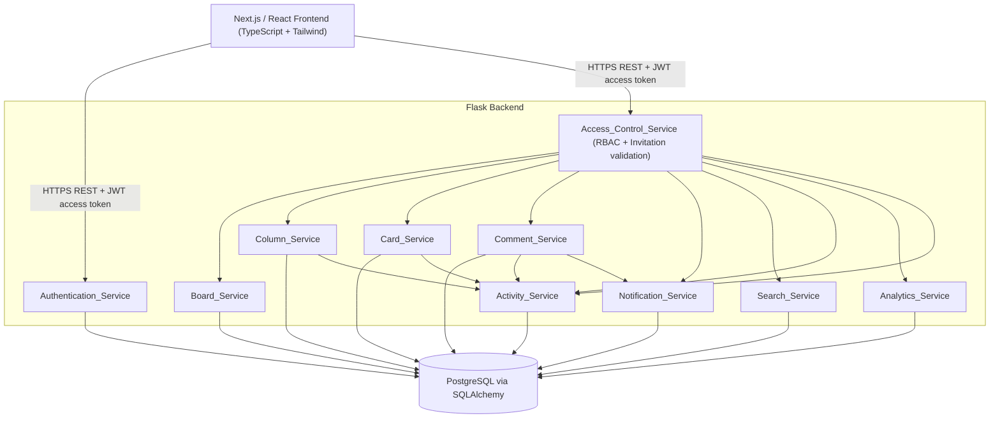
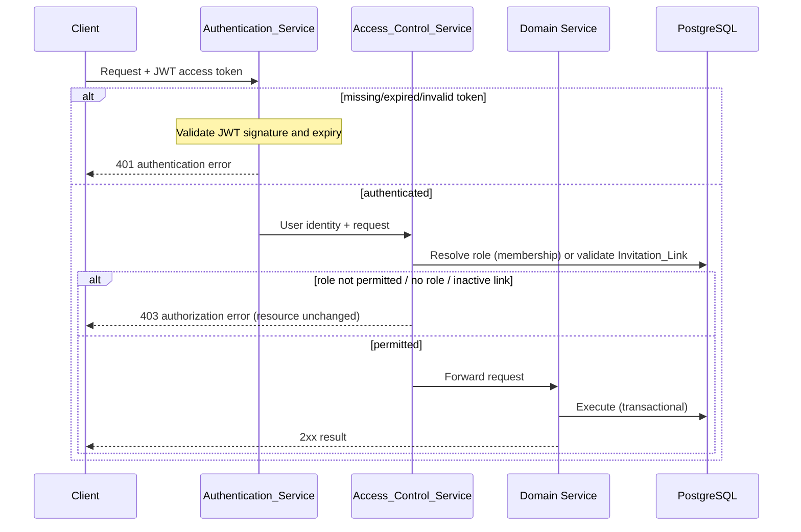
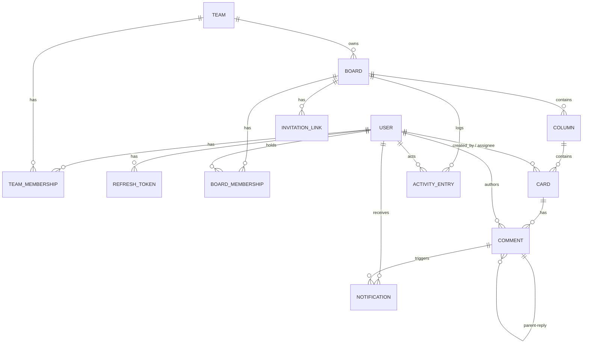

# Design Document

## Overview

This document specifies the technical design for a collaborative team task management web application (Trello-style). The system lets Teams organize work on Boards containing ordered Columns, each holding ordered Cards. It supports Card CRUD and drag-and-drop movement, threaded Comments, mention Notifications (HTTP polling), Card search, an Activity Log, Board Analytics, invitation-link Guest access, and role-based access control across Guest/Member/Admin roles, all gated behind email/password authentication.

The design traces directly to the acceptance criteria in `requirements.md`; requirement clauses are referenced inline as `R{n}.{m}` (for example, `R2.3` is Requirement 2, criterion 3).

### Technology Stack

- **Frontend:** Next.js (App Router) + React + TypeScript + Tailwind CSS. Drag-and-drop via a client library (e.g., `@dnd-kit/core`). HTTP polling for notifications.
- **Backend:** Flask + Python, organized as service modules behind a REST API. Flask blueprints map to the services named in the requirements glossary.
- **Database:** PostgreSQL accessed through SQLAlchemy ORM, with Alembic migrations.
- **Auth:** Stateless JWT access tokens (short-lived) + longer-lived refresh tokens; refresh tokens are revocable on logout. Passwords hashed with a slow KDF (bcrypt/argon2).

### Design Goals and Non-Functional Targets (R14)

- p95 latency < 300 ms for non-search, non-analytics, non-permanent-delete API requests under up to 100 concurrent users (R14.1). Achieved via indexed queries, bounded page sizes, and avoiding N+1 access with eager loading.
- 99.5% monthly availability measured by a health-check endpoint (R14.2).
- Responsive layouts: full board without horizontal scroll at >= 1024px (R14.3); usable, non-overlapping controls below 1024px (R14.4).
- Independent concurrent writes with no lost updates, enforced via optimistic concurrency (R14.5, R13).

## Architecture

### High-Level Topology



### Request Flow

Every API request flows through two gates before reaching a domain service:

1. **Authentication gate (Authentication_Service).** Validates the JWT access token's signature and expiry. If the request is unauthenticated, or the token is expired/invalid, it is rejected with an authentication error before any Board role is evaluated (R12.6, R15.9, R15.10).
2. **Authorization gate (Access_Control_Service).** Resolves the authenticated User's role on the target Board (or validates an Invitation_Link for Guest access), then either forwards the request to the target domain service or rejects it with an authorization error (R12.1–R12.5).



Role resolution reads the role claims embedded in the JWT access token (the token's embedded role snapshot), so role changes only take effect after the affected Member's access token is refreshed or re-issued; in-flight and already-authenticated requests keep their existing permissions (R10.3). See Authentication & Authorization below.

### Service Responsibilities

| Service | Responsibility | Primary Requirements |
| --- | --- | --- |
| Authentication_Service | Registration, login, logout (refresh-token revocation), JWT access-token issuance, token refresh, auth enforcement | R15, R12.6 |
| Access_Control_Service | RBAC decisions, membership/role management, invitation link lifecycle & validation, Guest read access | R10, R11, R12 |
| Board_Service | Board create/update/archive/restore/permanent-delete, default columns, settings | R1 |
| Column_Service | Column create/edit/reorder/delete with contiguous reindexing, empty-before-delete rule | R2 |
| Card_Service | Card CRUD, assignment, move/reorder with reindexing, position persistence, optimistic concurrency | R3, R4, R13 |
| Comment_Service | Top-level comments, threaded replies, edit/delete with cascade, optimistic concurrency | R5, R13 |
| Notification_Service | Create mention notifications, cursor-paginated retrieval, unread filter, mark-as-read | R6 |
| Search_Service | Case-insensitive title substring search across accessible boards, capped+ordered results | R7 |
| Activity_Service | Record and page Board activity entries | R8 |
| Analytics_Service | Card totals, per-column counts, completion rate, activity-by-day | R9 |

### Transactional Boundaries

All multi-step mutations (atomic multi-field updates R1.10/R3.10, reindexing R2.3/R2.5/R4.2, cascade delete R1.6/R5.4, create-with-side-effects) execute inside a single database transaction. Side effects that must be consistent with the primary write—Activity_Entry recording (R8) and Notification creation (R6.1)—are committed in the same transaction as the triggering operation so that an activity/notification exists if and only if its triggering mutation succeeded.

## Components and Interfaces

### Backend Layering

```
flask_app/
  app.py                 # app factory, blueprint registration, error handlers
  extensions.py          # SQLAlchemy db, migrate
  models/                # SQLAlchemy entities (Data Models section)
  auth/                  # Authentication_Service: routes + logic
  access/                # Access_Control_Service: RBAC decorators, membership, invitations
  boards/                # Board_Service
  columns/               # Column_Service
  cards/                 # Card_Service
  comments/              # Comment_Service
  notifications/         # Notification_Service
  search/                # Search_Service
  activity/              # Activity_Service
  analytics/             # Analytics_Service
  common/                # validation, ordering helpers, cursor codec, errors
```

### Cross-Cutting Interfaces

**RBAC decorator.** A `@require_role(board_param, min_role)` decorator wraps route handlers. It resolves the caller's effective role (from the JWT access token's role claims) on the target Board and either proceeds or raises `AuthorizationError`. For read endpoints it also accepts an Invitation_Link token granting Guest read access (R11.3, R12.2).

**Ordering helper.** A shared `reindex(items)` utility assigns contiguous `order_index` values `0..n-1` in the current sequence order. Used by Column reorder/delete (R2.3, R2.5) and Card move/reorder/delete (R4.2, R3.5).

**Cursor codec.** `encode_cursor(created_at, id)` / `decode_cursor(token)` serialize a `Notification_Cursor` (timestamp + id) into an opaque URL-safe string and validate it on decode (R6.7, R6.10).

**Error model.** A central error-to-HTTP mapper (see Error Handling) converts typed domain errors into consistent JSON responses.

### Frontend Structure

- **App Router pages:** `/login`, `/register`, `/boards`, `/boards/[boardId]` (board view with columns/cards + drag-and-drop), `/boards/[boardId]/activity`, `/boards/[boardId]/analytics`, `/boards/[boardId]/settings`, `/invite/[token]` (guest view), `/search`.
- **State/data:** A typed API client (fetch wrapper that attaches the JWT access token (and refreshes it via the refresh endpoint when expired) and surfaces typed errors). Notifications polled on an interval via the cursor endpoint.
- **Drag-and-drop:** Client computes the target column id and target order index, then calls the move endpoint; UI optimistically reorders and reconciles with the server's authoritative positions (R4.3).
- **Responsive layout:** Tailwind breakpoints render a horizontally laid out board at >= 1024px and a stacked/scrollable-per-column layout below it, avoiding horizontal page scroll and overlap (R14.3, R14.4).

## Data Models

All entities use a surrogate primary key (`id`, UUID or bigint). Timestamps are stored in UTC. `Card` and `Comment` carry a `version` integer used for optimistic concurrency (R13).



### Entities

**User** — registered account.
- `id`, `email` (unique, citext/lowercased), `password_hash`, `display_name`, `created_at`.
- `failed_login_attempts` (int, default `0`) — count of consecutive failed login attempts for the account; incremented on each failed login and reset to zero on a successful login (R15.4, R15.6).
- `locked_until` (timestamp, nullable, UTC) — when set and in the future, the account is locked and all login attempts are rejected; cleared on a successful login and effectively lifted once the timestamp has elapsed (R15.4, R15.5, R15.7).
- Unique constraint on `email` enforces R15.15. Password stored only as hash (R15.1).
- Lockout tracking: a failed login increments `failed_login_attempts` and, when the counter reaches 3, sets `locked_until = now + 15 minutes` (R15.4). A successful login sets `failed_login_attempts = 0` and clears `locked_until` (R15.6). Login handling treats an account as locked whenever `locked_until` is set and greater than the current time; once that window elapses, login is accepted again and the counter resets to zero (R15.5, R15.7).

**RefreshToken** — issued refresh credential enabling access-token minting.
- `id`, `user_id` (FK), `token_hash` (unique; the refresh token stored hashed, not plaintext), `issued_at`, `expires_at`, `revoked` (bool, default `false`), `created_at`.
- Logout sets `revoked = true` (R15.8). Refresh validates the token exists, is not revoked, and not expired (R15.11, R15.12).
- JWT access tokens are stateless and are not stored; only refresh tokens are persisted (hashed) to support revocation.

**Team** — owns Boards.
- `id`, `name`, `created_at`.

**TeamMembership** — User-in-Team join.
- `id`, `team_id` (FK), `user_id` (FK), `created_at`. Unique `(team_id, user_id)`.

**Board** — workspace belonging to a Team.
- `id`, `team_id` (FK), `name` (1–100 chars trimmed), `description` (0–2000 chars, default ""), `visibility` (enum: `private` | `team`, default `private`), `status` (enum: `active` | `archived`, default `active`), `created_at`, `updated_at`.
- Active listings filter `status = active` (R1.4, R1.5).

**BoardMembership** — User's role on a Board (RBAC source of truth).
- `id`, `board_id` (FK), `user_id` (FK), `role` (enum: `member` | `admin`), `created_at`. Unique `(board_id, user_id)`.
- Guest is not stored here; Guest access derives from an active Invitation_Link (R11). The "at least one Admin" invariant (R10.6) is checked against this table.

**Column** — ordered container in a Board.
- `id`, `board_id` (FK), `name` (1–100 chars trimmed), `order_index` (int, >= 0), `created_at`.
- Unique `(board_id, order_index)` and index on `(board_id, order_index)`. Order indices are contiguous `0..n-1` per board (R2.1, R2.3, R2.5). Default columns "To Do", "Doing", "Done" created at indices 0,1,2 on board creation (R1.2).

**Card** — task item in a Column.
- `id`, `column_id` (FK), `board_id` (FK, denormalized for search/analytics/scope checks), `title` (1–255 trimmed), `description` (0–5000, default ""), `assignee_id` (FK User, nullable), `due_date` (nullable), `created_by_id` (FK User), `created_at`, `updated_at`, `order_index` (int, >= 0), `version` (int, default 1).
- Index on `(column_id, order_index)` with unique `(column_id, order_index)`. Index on `(board_id, lower(title))` and `(board_id, updated_at desc, id desc)` to support search ordering (R7.6). `version` supports R13.

**Comment** — message on a Card, optionally threaded.
- `id`, `card_id` (FK), `author_id` (FK User), `parent_comment_id` (FK Comment, nullable), `body` (1–5000 non-whitespace), `created_at`, `edited_at` (nullable), `version` (int, default 1).
- Self-referential `parent_comment_id` models threaded replies; replies must share the same `card_id` as the parent (R5.2, R5.8). Deleting a comment cascades to all descendant replies (R5.4).

**Notification** — stored mention record.
- `id`, `recipient_id` (FK User), `comment_id` (FK Comment), `board_id` (FK), `status` (enum: `unread` | `read`, default `unread`), `created_at`.
- Unique `(recipient_id, comment_id)` enforces "exactly one Notification per distinct mentioned Member per Comment" (R6.1). Index on `(recipient_id, created_at desc, id desc)` and a partial variant filtered on `status = unread` to support cursor pagination and the unread-only filter (R6.2–R6.4, R6.7).

**InvitationLink** — shareable Guest-access token for a Board.
- `id`, `board_id` (FK), `token` (unique, high-entropy), `status` (enum: `active` | `inactive`, default `active`), `created_by_id` (FK User), `created_at`.
- Revocation flips `status` to `inactive` without touching other links (R11.2). Lookup by `token` validates Guest access (R11.3, R11.5, R11.6).

**ActivityEntry** — logged Board event.
- `id`, `board_id` (FK), `actor_id` (FK User), `event_type` (enum: `card_created`, `card_updated`, `card_moved`, `card_deleted`, `comment_created`, `comment_edited`, `comment_deleted`, `column_created`, `column_deleted`, `member_joined`, `member_removed`), `resource_id` (affected primary resource identifier), `secondary_resource_id` (nullable; e.g., Card id for comment events R8.6/R8.7, or target User id for member events R8.10/R8.11), `created_at`.
- Index on `(board_id, created_at desc, id desc)` for paged retrieval ordering (R8.12). `created_at` (UTC) also drives analytics activity-by-day grouping (R9.5).

### Version Identifiers and Optimistic Concurrency (R13)

`Card` and `Comment` expose `version` on retrieval (R13.1) and set it to `1` on creation (R13.4). An update must supply the expected `version`:
- Missing version → conflict error, resource unchanged (R13.5).
- Supplied version != current → conflict error, resource unchanged (R13.2).
- Supplied version == current → update applied, `version` incremented to a value distinct from all prior versions (monotonic increment) (R13.3).

Implementation uses a conditional `UPDATE ... WHERE id = :id AND version = :expected` returning the affected row count; zero rows means a conflict. The monotonic increment guarantees distinctness from every prior version.

## API Design

All endpoints are REST over HTTPS and (except auth endpoints noted below) require a valid JWT access token; unauthenticated requests get `401` before role evaluation (R12.6). Board-scoped endpoints additionally pass the RBAC gate. All request/response bodies are JSON. Standard error envelope is defined in Error Handling.

Common conventions:
- Resource create returns `201` with the created resource (and its `id`).
- Optimistic-concurrency writes on Cards/Comments require a `version` field in the body or an `If-Match`-style header; retrievals return the current `version` (R13).
- Collection ordering and caps are server-enforced, not client-controlled.

### Authentication_Service (R15)

| Method | Path | Auth | Purpose | Requirements |
| --- | --- | --- | --- | --- |
| POST | `/api/auth/register` | none | Create account; email valid-format, password >= 8 chars | R15.1, R15.14, R15.15, R15.16 |
| POST | `/api/auth/login` | none | Verify credentials; enforce account lockout; return access token (JWT) + refresh token; generic error on failure | R15.2, R15.3, R15.4, R15.5 |
| POST | `/api/auth/logout` | access token | Revoke the caller's refresh token | R15.8 |
| POST | `/api/auth/refresh` | refresh token | Exchange a valid, non-revoked refresh token for a new access token | R15.11, R15.12, R15.13 |
| GET | `/api/auth/me` | access token | Return current user and role claims read from the access token | R15.10 |

Login returns a short-lived JWT access token (carrying identity and Board role claims) plus a longer-lived refresh token (R15.2). Login failure returns a single generic `authentication error` that does not reveal whether email or password was wrong (R15.3). Login also enforces account lockout: while an account's `locked_until` is in the future the login is rejected with the same generic authentication error and no tokens are issued, even when the submitted credentials are valid and without revealing that the account is locked (R15.4, R15.5). Refresh exchanges a valid, non-revoked, non-expired refresh token for a new access token with current role claims (R15.11, R15.13); a revoked/expired/invalid refresh token is rejected with an authentication error and no token issued (R15.12).

### Board_Service (R1)

| Method | Path | Min Role | Purpose | Requirements |
| --- | --- | --- | --- | --- |
| POST | `/api/boards` | Admin (team) | Create board (+3 default columns) | R1.1, R1.2, R1.8 |
| GET | `/api/boards` | Member+ | List active boards the user can access | R1.4, R1.5 |
| GET | `/api/boards/{boardId}` | Member+/Guest(read) | Fetch board | R12 |
| PATCH | `/api/boards/{boardId}` | Admin | Partial update name/description/visibility atomically | R1.3, R1.8, R1.10 |
| POST | `/api/boards/{boardId}/archive` | Admin | Archive | R1.4 |
| POST | `/api/boards/{boardId}/restore` | Admin | Restore if archived | R1.5, R1.9 |
| DELETE | `/api/boards/{boardId}` | Admin | Permanent delete + cascade | R1.6 |

`PATCH` accepts any subset of `{name, description, visibility}`; omitted fields are left unchanged; any invalid supplied field rejects the whole request atomically (R1.3, R1.10). Non-Admins are rejected with an authorization error and no change (R1.7).

### Column_Service (R2)

| Method | Path | Min Role | Purpose | Requirements |
| --- | --- | --- | --- | --- |
| POST | `/api/boards/{boardId}/columns` | Admin | Create, append at end (index = count) | R2.1, R2.6 |
| PATCH | `/api/columns/{columnId}` | Admin | Rename | R2.2, R2.6 |
| POST | `/api/columns/{columnId}/reorder` | Admin | Move to target index, reindex contiguous | R2.3, R2.7 |
| DELETE | `/api/columns/{columnId}` | Admin | Delete only if empty, reindex remaining | R2.4, R2.5 |

Reorder body: `{ "targetIndex": int }`; out-of-range index rejected (R2.7). Delete of a non-empty column rejected with validation error (R2.4). Non-Admins rejected (R2.8).

### Card_Service (R3, R4, R13)

| Method | Path | Min Role | Purpose | Requirements |
| --- | --- | --- | --- | --- |
| POST | `/api/columns/{columnId}/cards` | Member+ | Create, append at end | R3.1, R3.2, R3.7 |
| GET | `/api/cards/{cardId}` | Member+/Guest(read) | Fetch card incl. `version` | R13.1 |
| PATCH | `/api/cards/{cardId}` | Member+ | Atomic multi-field edit; requires `version` | R3.3, R3.4, R3.7, R3.8, R3.9, R3.10, R13 |
| POST | `/api/cards/{cardId}/move` | Member+ | Move to target column + index, reindex | R4.1–R4.6 |
| DELETE | `/api/cards/{cardId}` | Member+ | Delete + reindex column | R3.5, R3.9 |

Move body: `{ "targetColumnId": id, "targetIndex": int }`. Validations: target column must be in same board (R4.4); target index integer in `[0, count]` (R4.5); Guests rejected (R4.6, R3.6). PATCH sets `updated_at` and bumps `version` (R3.3, R13.3).

### Comment_Service (R5, R13)

| Method | Path | Min Role | Purpose | Requirements |
| --- | --- | --- | --- | --- |
| GET | `/api/cards/{cardId}/comments` | Member+/Guest(read) | List comments (threaded) incl. `version` | R13.1 |
| POST | `/api/cards/{cardId}/comments` | Member+ | Create top-level or reply (`parentCommentId`) | R5.1, R5.2, R5.7, R5.8 |
| PATCH | `/api/comments/{commentId}` | Member+ (author) | Edit own; set `edited_at`, requires `version` | R5.3, R5.5, R5.7, R13 |
| DELETE | `/api/comments/{commentId}` | Member+ (author) | Delete own + cascade replies | R5.4, R5.5 |

Reply with invalid/other-card parent rejected (R5.8). Editing/deleting another user's comment rejected with authorization error (R5.5). Guests rejected (R5.6). Creating a comment triggers mention parsing → Notification creation (R6.1) and an Activity_Entry (R8.4), in the same transaction.

### Notification_Service (R6)

| Method | Path | Min Role | Purpose | Requirements |
| --- | --- | --- | --- | --- |
| GET | `/api/notifications?cursor=&unreadOnly=` | authenticated (recipient) | Cursor-paginated newest-first, <=50/page | R6.2, R6.3, R6.4, R6.6, R6.7, R6.10 |
| POST | `/api/notifications/{id}/read` | recipient | Mark as read | R6.5, R6.9 |

Ordering: `created_at DESC, id DESC`. Without `cursor`, return newest page; with `cursor`, return items strictly after the decoded `(created_at, id)` position (R6.2, R6.3, R6.6, R6.7). `unreadOnly=true` applies the same pagination over unread items only (R6.4). Response includes `{ items: [...], nextCursor }`; `nextCursor` encodes the last item's `(created_at, id)`. A malformed/invalid cursor yields a validation error and no items (R6.10). Marking a notification not addressed to the caller yields an authorization error, status unchanged (R6.9).

### Search_Service (R7)

| Method | Path | Min Role | Purpose | Requirements |
| --- | --- | --- | --- | --- |
| GET | `/api/search/cards?q=` | authenticated | Case-insensitive title substring over accessible boards | R7.1–R7.6 |

`q` must be 1–100 chars, non-whitespace-only; otherwise validation error and no results (R7.5). Results restricted to boards the caller can access (R7.3), each result includes its Board and Column (R7.2), ordered by `updated_at DESC, id DESC`, capped at 100 (R7.6). No matches → empty set (R7.4).

### Activity_Service (R8)

| Method | Path | Min Role | Purpose | Requirements |
| --- | --- | --- | --- | --- |
| GET | `/api/boards/{boardId}/activity?page=` | Member+/Guest(with active link) | Paged activity, newest first, <=100/page | R8.12, R8.13, R8.14, R8.15 |

Ordering `created_at DESC, id DESC`, 100 per page (R8.12). Each entry includes event type, timestamp, actor identity, affected resource id (R8.13). A page index that is negative or beyond the last page returns an empty page (R8.15). Callers with no role and no active invitation link are rejected (R8.14). Activity writing is performed internally by the triggering services (R8.1–R8.11).

### Analytics_Service (R9)

| Method | Path | Min Role | Purpose | Requirements |
| --- | --- | --- | --- | --- |
| GET | `/api/boards/{boardId}/analytics` | Member+ | Totals, per-column counts, completion rate, activity-by-day | R9.1–R9.6 |

Response: `{ totalCards, perColumn: [{columnId, count}], completionRate, activityByDay: [{day, count}] }`. `completionRate` = (sum of card counts across all columns named exactly "Done") / totalCards, in `[0.0, 1.0]` (R9.3); `0` when zero cards (R9.4) or no "Done" column (R9.6). Activity grouped by UTC calendar day (R9.5).

### Access_Control_Service: Membership & Invitations (R10, R11)

| Method | Path | Min Role | Purpose | Requirements |
| --- | --- | --- | --- | --- |
| POST | `/api/boards/{boardId}/members` | Admin | Invite user with role member/admin | R10.1, R10.4, R10.5, R10.7 |
| PATCH | `/api/boards/{boardId}/members/{userId}` | Admin | Change role (effective after token refresh) | R10.3, R10.6, R10.7 |
| DELETE | `/api/boards/{boardId}/members/{userId}` | Admin | Remove member | R10.2, R10.6, R10.7 |
| POST | `/api/boards/{boardId}/invitations` | Admin | Generate invitation link | R11.1, R11.7 |
| POST | `/api/invitations/{token}/revoke` | Admin | Revoke link (set inactive) | R11.2, R11.7 |

Invite with role other than member/admin → validation error (R10.4); inviting an existing member → validation error (R10.5). Any removal/role-change that would leave zero Admins → validation error (R10.6). Non-Admins rejected (R10.7, R11.7). Member grant records a "member joined" activity (R8.10); removal records "member removed" (R8.11).

## Authentication & Authorization

### Session / Token Model (R15, R10.3)

On successful login the Authentication_Service issues a short-lived **Access_Token** — a JSON Web Token (JWT) containing the user id, issue/expiry timestamps, and the user's **Board role claims** — together with a longer-lived **Refresh_Token** (R15.2). The access token is stateless (verified by signature); the refresh token is persisted hashed in the `RefreshToken` table to support revocation.

Each request:

1. Validates the JWT access token's signature and expiry → reject with an authentication error before any role evaluation if the access token is missing, expired, or invalid (R15.9, R15.10, R12.6).
2. Reads the role claims embedded in the validated JWT for authorization decisions on this request (R12, R10.3).

**Logout** revokes the Refresh_Token (the stored refresh-token record is marked `revoked = true`, i.e., added to the server-side revocation list), so no new Access_Token can be minted from it; the short-lived access token is not stored and simply expires on its own (R15.8).

**Token refresh:** a valid, non-revoked, non-expired Refresh_Token yields a new Access_Token whose role claims are current as of the time the new token is issued (R15.11, R15.13). A revoked, expired, or invalid Refresh_Token is rejected with an authentication error and no token is issued (R15.12).

**Account lockout.** The Authentication_Service tracks the number of *consecutive* failed login attempts per account (`User.failed_login_attempts`). The lockout is per account and based strictly on consecutive failures. When a login attempt is the third consecutive failure for that account, the account is locked for 15 minutes starting at the moment of that third failure (`locked_until = now + 15 minutes`) (R15.4). While `locked_until` is set and in the future, every login attempt for that account is rejected with the same generic authentication error used for ordinary invalid credentials and no Access_Token or Refresh_Token is issued — even when the submitted credentials are correct — and the error never discloses that the account is locked (R15.5, consistent with the non-disclosure rule R15.3). A successful login resets the consecutive-failure counter to zero and clears `locked_until` (R15.6). Once the 15-minute window has elapsed (`locked_until` is no longer in the future), login attempts are accepted again and the consecutive-failure counter is reset to zero (R15.7).

Because role claims live in the access token, an Admin changing a Member's role updates the stored `BoardMembership`, but the affected Member keeps their old permissions until their access token is refreshed or re-issued (which re-reads `BoardMembership` to build fresh claims); in-flight and already-authenticated requests are unaffected (R10.3).

Passwords are verified against the stored hash (R15.1). Registration validates email format and password length (R15.14, R15.16) and rejects duplicate emails via the unique constraint (R15.15).

### RBAC Enforcement Flow (R12)

The Access_Control_Service maps each operation to a minimum capability and evaluates it against the caller's effective role on the target Board:

- **Unauthenticated** → authentication error before any role check (R12.6).
- **Guest** (active Invitation_Link only): read Columns/Cards/Comments; all create/edit/delete/move/reorder rejected with authorization error, board unchanged (R11.3, R11.4, R12.2).
- **Member**: Card ops, Comment ops, search, notifications, analytics; Column/member/settings/lifecycle rejected (R12.3).
- **Admin**: all Member ops plus Column management, member management, Board settings and lifecycle (R12.4).
- **No role and no active link** on the referenced Board → authorization error, board unchanged (R12.5, R8.14).

Capability matrix:

| Operation group | Guest | Member | Admin |
| --- | --- | --- | --- |
| Read columns/cards/comments | allow | allow | allow |
| Card create/edit/delete/move/reorder | deny | allow | allow |
| Comment create/edit/delete (own) | deny | allow | allow |
| Search / notifications / analytics | deny | allow | allow |
| Column create/edit/reorder/delete | deny | deny | allow |
| Member & settings & board lifecycle | deny | deny | allow |

### Invitation Link / Guest Access (R11)

An Admin generates an Invitation_Link bound to one Board, returned as a unique token (R11.1). A request presenting the token is authorized as Guest (read-only) iff the link exists and is `active` (R11.3). Inactive link → authorization error (R11.5); unknown token → authorization error (R11.6). Revocation sets only that link to `inactive` (R11.2). Guests attempting any write are rejected with the affected resource unchanged (R11.4).

## Key Behaviors and Invariants

### Contiguous Ordering with Reindexing (R2, R3, R4)

- **Columns:** After create (append at `count`), reorder, or delete, the Board's column `order_index` values form a contiguous sequence `0..n-1` with no gaps or duplicates (R2.1, R2.3, R2.5). Reorder clamps/validates the target to `[0, n-1]` (R2.7).
- **Cards:** After create (append at end), move, reorder, or delete, each affected Column's card `order_index` values form a contiguous sequence `0..m-1` (R3.2, R3.5, R4.2). Move validates target index in `[0, count-in-target-after-removal]` and same-board target column (R4.1, R4.4, R4.5).
- Reindexing uses the shared `reindex()` helper inside the mutation's transaction so retrieval reflects the normalized sequence (R4.3).

### Atomic Multi-Field Updates (R1, R3)

Board `PATCH` and Card `PATCH` validate all supplied fields first; if any is invalid the entire request is rejected and no field changes (R1.10, R3.10). Valid partial updates leave omitted fields unchanged (R1.3).

### Optimistic Concurrency (R13)

Card/Comment updates require the expected `version`; mismatch or missing version → conflict error with resource unchanged; success bumps `version` monotonically (R13.2, R13.3, R13.5). This prevents silent lost updates for concurrent editors (R14.5).

### Cascade and Empty-Before-Delete (R1, R2, R5)

- Permanent board deletion cascades to Columns, Cards, Comments, and Activity_Entries (R1.6) via DB cascade/explicit transactional deletes.
- A Column can be deleted only when it has no Cards; otherwise a validation error, unchanged (R2.4).
- Deleting a Comment removes it and all transitive replies (R5.4).

### Analytics Completion Rate (R9)

`completionRate = (sum of card counts over every column whose name == "Done") / totalCards`, clamped to `[0,1]`; returns `0` when `totalCards == 0` (R9.4) or no "Done" column exists (R9.6). Summing across all "Done"-named columns handles boards with more than one such column (R9.3).

### Mention Notifications (R6)

Comment creation parses mention tokens, resolves them to board members, and creates exactly one unread Notification per distinct mentioned member (deduped by the unique `(recipient_id, comment_id)` constraint) (R6.1). Mentions of non-members produce no notification (R6.8).

## Correctness Properties

*A property is a characteristic or behavior that should hold true across all valid executions of a system — essentially, a formal statement about what the system should do. Properties serve as the bridge between human-readable specifications and machine-verifiable correctness guarantees.*

These properties are derived from the acceptance-criteria prework. Redundant criteria were consolidated (for example, all ordering criteria fold into contiguity properties, and all RBAC-denial criteria fold into a single authorization-decision property).

### Property 1: Column ordering is always contiguous from zero

*For any* Board and *any* sequence of column create, rename, reorder (to a valid target index), and empty-column delete operations, after each operation the Board's column `order_index` values form a contiguous sequence `0..n-1` with no gaps or duplicates, a created column is appended at index equal to the prior column count, and a reordered column ends at its requested target index.

**Validates: Requirements 2.1, 2.3, 2.5**

### Property 2: Card ordering is always contiguous from zero

*For any* Board and *any* sequence of card create, delete, move, and reorder operations with valid targets, after each operation every affected Column's card `order_index` values form a contiguous sequence `0..m-1` with no gaps or duplicates, a created card is appended at the end of its column, and a moved card ends in the target Column at the target index.

**Validates: Requirements 3.2, 3.5, 4.1, 4.2**

### Property 3: Card position round-trip persistence

*For any* valid card move or reorder, retrieving the card after the operation returns the same Column assignment and order index that were applied.

**Validates: Requirements 4.3**

### Property 4: Out-of-range or cross-board moves leave position unchanged

*For any* move or reorder request whose target index is non-integer, negative, or exceeds the maximum valid index, or whose target column belongs to a different Board, the request is rejected and the card's Column assignment and order index are unchanged.

**Validates: Requirements 2.7, 4.4, 4.5**

### Property 5: Board partial update preserves omitted fields; invalid field rejects atomically

*For any* Board and *any* update containing a subset of `{name, description, visibility}`: if all supplied fields are valid, each supplied field equals its input and each omitted field equals its prior value; if any supplied field is invalid, every Board field is unchanged.

**Validates: Requirements 1.3, 1.10**

### Property 6: Card edit is atomic across multiple fields

*For any* multi-field Card edit among `{Title, Description, Assignee, Due date}`, if any supplied field is invalid the entire request is rejected and all Card fields remain unchanged; otherwise all supplied fields are persisted and `updated_at` advances.

**Validates: Requirements 3.3, 3.10**

### Property 7: Input validation rejects invalid values and leaves state unchanged

*For any* Board name, Column name, Card title, or Comment body that violates its length/whitespace rule (name empty-after-trim or over its max; title whitespace-only or over 255; comment body empty, whitespace-only, or over 5000), the corresponding create/edit request is rejected with a validation error and no stored data changes.

**Validates: Requirements 1.8, 2.6, 3.7, 5.7**

### Property 8: Assignment requires board membership

*For any* Card and *any* candidate assignee, assignment succeeds and sets the Assignee when the candidate is a current Member of the Card's Board, and is rejected with the Assignee unchanged otherwise.

**Validates: Requirements 3.4, 3.8**

### Property 9: Non-empty column cannot be deleted

*For any* Column containing one or more Cards, a delete request is rejected and the Column and its Cards are unchanged.

**Validates: Requirements 2.4**

### Property 10: Board permanent delete cascades completely

*For any* Board with arbitrary Columns, Cards, Comments, and Activity_Entries, after a permanent delete none of those descendant records remain.

**Validates: Requirements 1.6**

### Property 11: Comment deletion removes the entire reply subtree

*For any* Comment reply tree, deleting a Comment removes that Comment and all directly or indirectly linked replies, while Comments outside that subtree remain unchanged.

**Validates: Requirements 5.4**

### Property 12: Reply threading validity

*For any* reply request, a Comment is created linked to the parent when the parent exists and belongs to the same Card, and is rejected with no Comment created when the parent does not exist or belongs to a different Card.

**Validates: Requirements 5.2, 5.8**

### Property 13: Mentions create exactly one unread notification per distinct board member

*For any* Comment whose body mentions an arbitrary multiset of users (including duplicates and non-members), the system creates exactly one unread Notification for each distinct mentioned user who is a Member of the Board and creates no Notification for mentioned users who are not Board Members.

**Validates: Requirements 6.1, 6.8**

### Property 14: Notification cursor pagination visits each notification exactly once in order

*For any* set of Notifications for a recipient, paging from the first page through successive cursors (with or without the unread-only filter) returns pages of at most 50 items ordered by `created_at` descending with id descending as tie-break, such that every qualifying Notification is returned exactly once with no gaps and no duplicates across pages.

**Validates: Requirements 6.2, 6.3, 6.4, 6.6, 6.7**

### Property 15: Notification cursor codec round-trip

*For any* valid `(created_at, id)` position, decoding its encoded cursor yields the original position; and *for any* malformed cursor string, decoding is rejected with a validation error and the retrieval returns no Notifications.

**Validates: Requirements 6.10**

### Property 16: Search result soundness, completeness, content, ordering, and cap

*For any* keyword of 1–100 non-whitespace characters and *any* dataset, every returned Card's Title contains the keyword as a case-insensitive substring and belongs to a Board the requester can access, every accessible matching Card is represented (up to the cap), each result carries its Board and Column, and when more than 100 Cards match the result is the first 100 ordered by `updated_at` descending with Card id descending as tie-break.

**Validates: Requirements 7.1, 7.2, 7.3, 7.6**

### Property 17: Activity entries are recorded faithfully for each tracked event

*For any* tracked Board event (card created/updated/moved/deleted, comment created/edited/deleted, column created/deleted, member joined/removed), exactly one Activity_Entry is recorded with the correct event type, acting User identity, affected resource identifier(s), and a timestamp.

**Validates: Requirements 8.1, 8.2, 8.3, 8.4, 8.5, 8.6, 8.7, 8.8, 8.9, 8.10, 8.11, 8.13**

### Property 18: Activity pagination visits each entry exactly once in order

*For any* set of Activity_Entries for a Board, paging through valid page indices returns pages of at most 100 entries ordered by `created_at` descending with id descending as tie-break such that every entry appears exactly once across pages, and any negative or beyond-last page index returns an empty page.

**Validates: Requirements 8.12, 8.15**

### Property 19: Analytics counts and completion rate are consistent and bounded

*For any* Board, the reported total Card count equals the number of Cards, the per-Column counts are non-negative and sum to the total, the completion rate equals the sum of Card counts across all Columns named exactly "Done" divided by the total (and is `0` when there are no Cards or no "Done" Column), the completion rate always lies in the closed interval `[0.0, 1.0]`, and the per-UTC-day activity counts sum to the total number of Activity_Entries.

**Validates: Requirements 9.1, 9.2, 9.3, 9.4, 9.5, 9.6**

### Property 20: Optimistic concurrency prevents silent overwrites

*For any* Card or Comment and *any* update request, the update is applied only when the supplied version identifier matches the current version, in which case a new version identifier distinct from every prior version of that resource is assigned; an update with a missing version or a non-matching version is rejected with a conflict error and the resource is unchanged.

**Validates: Requirements 13.2, 13.3, 13.5, 14.5**

### Property 21: RBAC authorization decisions match the role capability matrix

*For any* authenticated User, *any* Board role (Guest via active link, Member, Admin, or no role), and *any* operation, the authorization decision permits the operation if and only if the role's capability set includes it; denied write operations leave the referenced resource unchanged, and a User with no role and no active Invitation_Link on the Board is denied.

**Validates: Requirements 1.7, 2.8, 3.6, 4.6, 5.5, 5.6, 8.14, 10.7, 11.4, 11.7, 12.1, 12.2, 12.3, 12.4, 12.5**

### Property 22: Authentication gate precedes authorization

*For any* request lacking a valid, unexpired JWT access token, the request is rejected with an authentication error before any Board role is evaluated.

**Validates: Requirements 12.6, 15.9, 15.10**

### Property 23: Board retains at least one Admin

*For any* Board and *any* member removal or role-change request, the request is rejected and membership is unchanged if it would reduce the number of Admins to zero; consequently the Admin count is always at least one.

**Validates: Requirements 10.6**

### Property 24: Role changes apply only to refreshed access tokens

*For any* role change on a Board, authorization decisions evaluated against the role claims of a JWT access token issued before the change use the old role, while decisions evaluated against an access token refreshed or re-issued after the change use the new role.

**Validates: Requirements 10.3**

### Property 25: Invitation link generation, isolation, and access control

*For any* set of Invitation_Links on a Board, a newly generated link is active, uniquely identifiable, and bound to that Board; revoking one link sets only that link to inactive and leaves all others unchanged; access via an active link grants read-only Board access while rejecting writes; and access via an inactive link is rejected.

**Validates: Requirements 11.1, 11.2, 11.3, 11.5**

### Property 26: Passwords are stored hashed and verifiable

*For any* valid registration, the stored credential is not the plaintext password and the password verifies against the stored hash.

**Validates: Requirements 15.1**

### Property 27: Login failures do not disclose which field was wrong

*For any* login attempt with a wrong email or a wrong password, the system returns the same generic authentication error without indicating which field was incorrect.

**Validates: Requirements 15.3**

### Property 28: Registration validation enforces email format and password length

*For any* registration request, the account is created only when the email is in valid format and the password has at least 8 characters; otherwise the request is rejected with a validation error and no account is created.

**Validates: Requirements 15.14, 15.16**

### Property 29: Refresh-token exchange and revocation

*For any* refresh token, exchanging a valid, non-revoked, non-expired refresh token yields a new access token whose role claims reflect the user's current Board roles at issuance; a revoked, expired, or unknown refresh token yields an authentication error and no access token is issued.

**Validates: Requirements 15.11, 15.12, 15.13**

### Property 30: Account lockout after three consecutive failed logins

*For any* account and *any* sequence of login attempts, after three consecutive failed login attempts the account is locked for 15 minutes during which every login attempt (including one with correct credentials) is rejected with a generic authentication error and no tokens are issued; a successful login before the third failure, or the elapse of the 15-minute window, resets the consecutive-failure count so the account accepts logins again.

**Validates: Requirements 15.4, 15.5, 15.6, 15.7**

## Error Handling

### Error Taxonomy and HTTP Mapping

All domain services raise typed errors that a central Flask error handler maps to a consistent JSON envelope: `{ "error": { "code": string, "message": string, "field": string? } }`.

| Error type | HTTP | When | Example requirements |
| --- | --- | --- | --- |
| `AuthenticationError` | 401 | Missing/expired/invalid JWT access token; invalid login; login attempt against a locked account; revoked/expired/invalid refresh token on refresh | R12.6, R15.3, R15.5, R15.9, R15.10, R15.12 |
| `AuthorizationError` | 403 | Role/invitation forbids operation | R1.7, R5.5, R10.7, R11.x, R12.x, R6.9 |
| `ValidationError` | 400 | Invalid input (name/title/body/keyword/role/cursor), out-of-range index, invalid assignee, invalid parent | R1.8, R2.6/2.7, R3.7/3.8, R4.4/4.5, R5.7/5.8, R6.10, R7.5, R10.4/10.5, R15.14/15.16 |
| `NotFoundError` | 404 | Referenced resource does not exist | R3.9 |
| `ConflictError` | 409 | Version mismatch/missing; duplicate email; last-admin; already-member; not-archived restore | R13.2/13.5, R15.15, R10.6, R10.5, R1.9 |

### Atomicity and Rollback

Every mutating request runs in a single transaction. On any raised domain error the transaction rolls back, guaranteeing the "leave unchanged" clauses pervasive in the requirements (for example R1.10, R2.4, R3.10, R4.4, R13.2). Reindexing, cascade deletes, activity logging, and notification creation are part of the same transaction as their trigger.

### Validation Strategy

- **Trimming and length:** Names/titles are trimmed before length checks; comment bodies are checked for non-whitespace content (R1.1, R2.1, R3.1, R5.1).
- **Enums:** `visibility`, `status`, membership `role`, and `event_type` validated against allowed sets; invalid role on invite → `ValidationError` (R10.4).
- **Indices:** Reorder/move target indices validated against current counts before mutation (R2.7, R4.5).
- **Cursor:** Decoded and structurally validated (timestamp + id). Malformed cursor → `ValidationError` and empty result (R6.10).
- **Not-found vs forbidden:** Existence checks occur after the authorization gate; read authorization failures return `AuthorizationError` rather than leaking existence.

### Security Considerations

- Passwords hashed with bcrypt/argon2; never logged or returned (R15.1).
- Generic login error prevents account enumeration (R15.3).
- Account lockout mitigates brute-force and credential-stuffing attacks: 3 consecutive failed logins lock the account for 15 minutes, during which all login attempts fail; the generic authentication error avoids disclosing the locked state (R15.4, R15.5).
- JWT access tokens are stateless and short-lived, verified by signature and expiry on every request (R15.9, R15.10).
- Refresh tokens are stored hashed (never plaintext) and are revocable; logout marks the refresh token revoked so it can no longer mint access tokens (R15.8, R15.12).
- Invitation tokens are high-entropy and only grant Guest read on their bound Board (R11).
- Authorization decisions read the role claims embedded in the JWT access token, isolating in-flight requests from role changes until the access token is refreshed/re-issued (R10.3).

## Testing Strategy

### Dual Approach

The feature is a stateful web application with substantial pure logic (ordering/reindexing, completion-rate arithmetic, cursor pagination, optimistic-concurrency version checks, RBAC decision function, validation, cascade computation). This pure logic is well suited to property-based testing, so the strategy combines:

- **Property-based tests** for the universal properties in the Correctness Properties section — ordering contiguity, pagination completeness, analytics bounds, RBAC decisions, concurrency, validation, cascade.
- **Example-based unit tests** for concrete scenarios and supporting criteria (default-column creation R1.2, archive/restore flows R1.4/1.5, mark-as-read R6.5, login issuing access+refresh tokens and logout revoking the refresh token R15.2/15.8, token refresh issuing a new access token R15.11, version present on retrieval R13.1/13.4).
- **Edge-case unit tests** for specific error conditions (restore non-archived R1.9, not-found card R3.9, duplicate email R15.15, out-of-range activity page R8.15, unknown invitation token R11.6, mark others' notification R6.9).
- **Integration tests** for non-functional and infrastructure concerns: performance/p95 under load (R14.1), availability health-check (R14.2), responsive layout at/below 1024px (R14.3/14.4), and real concurrent-writer no-lost-update behavior (R14.5), plus account-lockout flows — locking after 3 consecutive failed logins and unlocking after the 15-minute window (R15.4–R15.7); the time-based unlock (R15.7) is validated with a controllable/injected clock — plus end-to-end API wiring through the auth and RBAC gates.

### Property-Based Testing Setup

- **Backend (Python/Flask):** use `hypothesis` for property-based tests against the pure domain logic (ordering helpers, analytics computation, cursor codec, RBAC decision function, validation, version checks). Do not implement a PBT framework from scratch.
- **Frontend (TypeScript):** use `fast-check` for any client-side pure logic that warrants it (e.g., drag target-index computation), though most properties live in the backend domain layer.
- **Configuration:** every property-based test runs a minimum of 100 generated cases (`@given` with `settings(max_examples=100)` in Hypothesis; `{ numRuns: 100 }` in fast-check).
- **Traceability tag:** each property test includes a comment tagging it to the design property, in the format:
  `# Feature: task-management-app, Property {number}: {property_text}`

Each of the 30 correctness properties is implemented by a single property-based test. Generators model the relevant domain objects (boards, columns with cards, comment trees, mention multisets, notification sets with timestamps, membership/role sets, version sequences) and include edge cases (empty collections, whitespace-only strings, non-ASCII, boundary lengths, duplicate mentions, equal timestamps for tie-break coverage).

### Example and Integration Coverage Notes

- Database-backed tests run against a transactional test PostgreSQL (or a disposable schema) with rollback per test to keep them fast and isolated.
- Pure-logic properties are tested without the database where possible by extracting ordering/analytics/cursor/RBAC logic into side-effect-free functions.
- Load and responsive tests (R14) are explicitly out of the property-based scope and are validated by integration/performance and visual-regression tooling.
